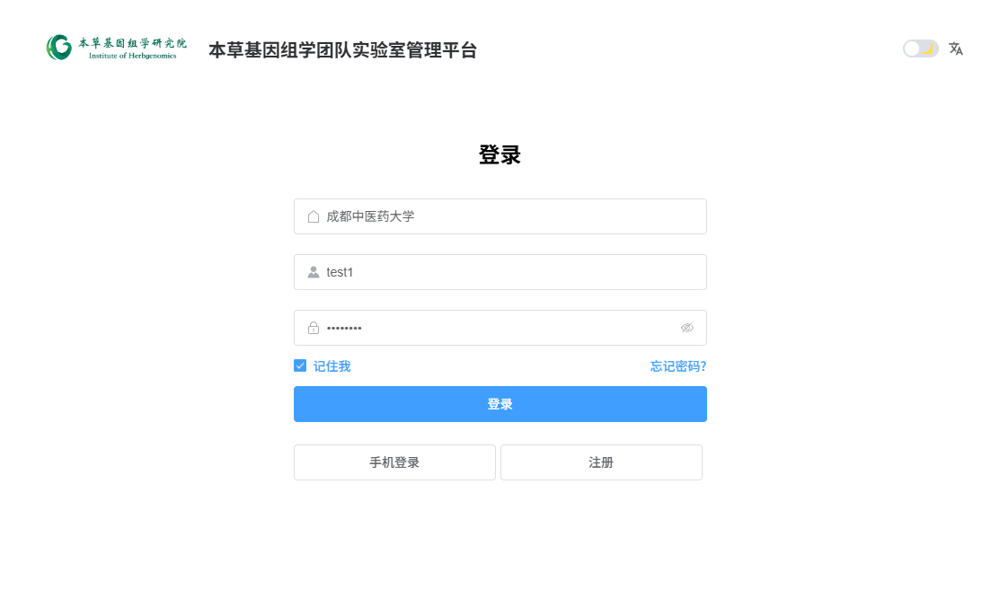
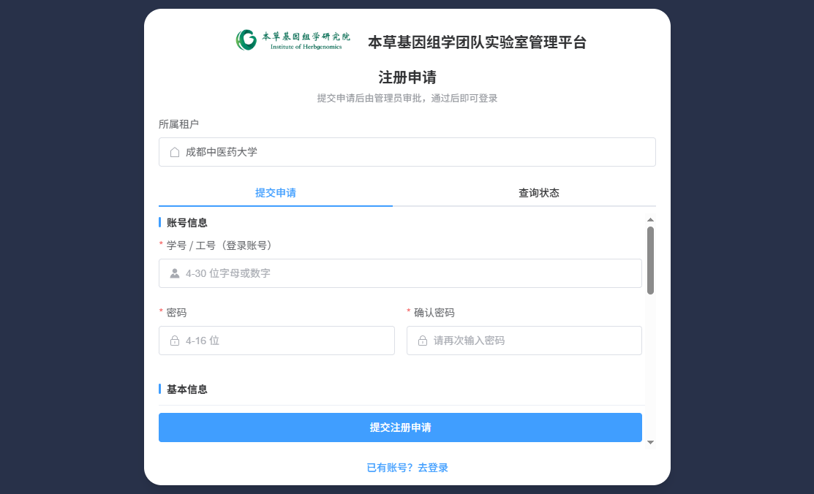

# 01 平台功能与角色权限总览

| 项目 | 内容 |
|---|---|
| 文档名称 | 本草基因组学团队实验室管理平台——平台功能与角色权限总览 |
| 适用版本 | 当前开发环境（2026-10-20 核验） |
| 核验方式 | 前后端源码审阅 + 数据库实查（租户 162） + 运行页面登录截图 |
| 面向读者 | 实验室全体成员、各级管理员、验收人员 |

---

## 1. 这个平台是做什么的

本平台是"本草基因组学团队"的实验室信息化管理系统，覆盖三大业务板块：

1. **仪器管理**：把实验室的仪器（设备）建档，管理仪器从"启用 → 预约 → 使用 → 故障/停用/报废"的完整生命周期。普通成员先申请"使用资质"，通过后可以在网上预约仪器时段，管理员和仪器负责人对预约进行审批式管理（完成登记 / 作废）。
2. **质粒管理**：对实验室的质粒样本进行登记、审核入库、库存管理、借用归还、违规与黑名单管理，实现"谁登记、谁审核、谁保管、谁借用、还了多少"全程留痕。
3. **用户与注册管理**：新成员在网上提交注册申请，审批专员/管理员通过后自动开通账号并授予"普通用户"角色；管理员可继续维护用户、角色与权限。

一句话概括：

> **先建好实验室档案（平台、房间、仪器）→ 配好预约规则和负责人 → 成员申请资质 → 资质通过后网上预约仪器 → 用完由负责人登记完成或作废；质粒样本从登记入库到借用归还有独立的账本体系。**

## 2. 重要环境提示（必读）

> **【预约创建开关（C7）当前状态：已开启】**
>
> 截至本手册编制日（2026-10-20），当前开发环境的"预约创建"功能开关处于**开启**状态，普通用户可以实际提交新预约。
>
> 请注意：该开关默认**关闭**，由系统负责人在后端配置中控制。开关关闭时，页面预约弹窗会提示"预约创建处于受控开放阶段"，提交时服务端返回错误码 **116（功能未开放）**。设备卡片上显示"立即预约"按钮，只代表设备档案允许预约，**不代表当前一定能提交成功**。
>
> 正式部署或验收前，请向系统负责人确认该开关的实际状态。

## 3. 如何登录、如何获得账号

1. 打开浏览器访问系统地址（当前环境为 `http://localhost`，正式环境以负责人通知为准）。
2. 登录页输入用户名（学号/工号）与密码，点击登录。登录页见 **图1**。



3. **没有账号的新成员**：点击登录页右下角「注册」按钮，进入注册申请页（见 **图2**），填写学号/工号、密码、姓名、手机号、邮箱、身份类别、研究方向等信息后提交，等待审批。审批通过后即可用注册时填写的用户名和密码直接登录（详见《06-注册审批与用户管理指南》）。



4. 登录后可点击右上角头像 → 「个人中心」修改昵称、手机号、邮箱、上传头像、重置密码（见 **图15**）。


## 4. 系统角色总览

当前租户（成都中医药大学）共配置 6 个业务角色。**角色决定你能看到哪些菜单、能用哪些按钮。**

| 角色 | 角色编码 | 一句话定位 |
|---|---|---|
| 租户管理员 | tenant_admin | 系统级管理员：管用户、角色、菜单、租户参数等系统管理功能；也拥有实验室档案、设备、资质审核、信用、暂停等管理权限 |
| 普通用户 | 普通用户 | 实验室普通成员：浏览仪器、申请资质、预约仪器、管理自己的预约；登记质粒、借用归还质粒 |
| 库管员 | lab_keeper | 质粒仓库管理员：质粒审核入库、出入库、借用归还审核、违规与黑名单管理。**与仪器预约无关** |
| 本草基因管理员 | lab_admin | 实验室日常运行管理员：实验室档案与仪器的全部管理、资质审批、预约规则配置、预约管理、信用与暂停管理、注册审批、公告、质粒全流程 |
| 注册审批员 | registration_approver | 专职审批新用户注册申请（登录后只见"注册审批"一个菜单） |
| 仪器设备负责人 | instrument_device_manager | 被指定负责某台/某些设备的人：审核该设备资质申请、管理该设备预约（完成/作废等） |

另有一个框架内置的**超级管理员（super_admin）**，拥有全部权限，一般不参与日常业务。

### 4.1 本草基因管理员（lab_admin）与租户管理员（tenant_admin）的区别

这是客户最容易混淆的一对角色，务必区分：

| 对比项 | 租户管理员（903） | 本草基因管理员（906） |
|---|---|---|
| 定位 | **系统级**管理员，管理平台本身（账号、角色、菜单、租户参数、系统日志等） | **实验室业务级**管理员，管理实验室日常运行 |
| 用户管理 | 全部权限（含恢复已删用户） | 有，但缺"用户恢复" |
| 角色管理 | 全部权限（可新增/修改/删除角色、分配菜单权限） | **只能查看**（只读） |
| 系统管理菜单 | 全部（用户/角色/菜单/部门/岗位/字典/租户/日志等） | 仅用户管理、角色管理（只读）、注册审批 |
| 基础设施/工作流程/监控等框架菜单 | 有 | 无 |
| 实验室公告 | 有 | 有 |
| 质粒管理 | 全部 | 全部 |
| 仪器档案（平台/房间/设备/负责人/须知） | 有 | 有 |
| 资质审核/信用管理/暂停管理 | 有 | 有 |
| **预约配置（预约规则）** | **无** | **有** |
| **预约管理（预约查询/完成/作废）** | **无** | **有** |
| 我的预约/我的资质/我的信用 | 有 | 有 |

> 简单记：**管系统找租户管理员，管实验室找本草基因管理员**。预约规则和预约管理只归本草基因管理员（以及被授权的设备负责人），租户管理员反而没有。

### 4.2 仪器设备负责人：角色 + 业务关系 = 双条件

"仪器设备负责人"页面能看到什么由**角色**决定；能管理**哪台设备**由"仪器负责人"页面建立的**业务关系**决定。只有两者同时满足，才真正具备某台设备的管理能力：

- 角色被授予"仪器设备负责人"（或管理员角色）→ 有资格看到"资质审核""预约管理"菜单；
- 管理员在"仪器管理 → 仪器负责人"中把某人指定为某设备的负责人 → 此人才能在资质审核/预约管理中看到**这台设备**的申请与预约。

角色被移除 → 菜单消失；业务关系被解除 → 对应设备的数据消失。两者互不等价（详见《05-仪器负责人和维修负责人操作指南》）。

## 5. 菜单总览（与页面一致）

登录后左侧菜单树如下（各角色可见范围不同，见第 6 节矩阵）：

```
实验室管理
├─ 实验室公告管理        （公告的维护入口，管理端页面）
├─ 质粒管理
│  ├─ 质粒库             （质粒档案登记/查询）
│  ├─ 质粒类型           （质粒分类与库管员指定）
│  ├─ 质粒审核           （库管员入库验收台）
│  ├─ 质粒库存
│  │  ├─ 库存台账        （当前库存、出入库/盘点/调整/阈值）
│  │  └─ 库存流水        （库存变动对账单，只读）
│  ├─ 质粒借用           （借用申请与审核）
│  ├─ 质粒归还           （归还申请与审核）
│  ├─ 违规记录           （违规登记与处理）
│  ├─ 借用黑名单         （借用资格限制）
│  └─ 存放位置           （冰箱→层→盒→盒内位置台账）
└─ 仪器管理
   ├─ 仪器大厅           （面向所有人的仪器浏览/预约入口）
   ├─ 仪器详情           （隐藏菜单，从大厅点击卡片进入）
   ├─ 我的使用资质       （个人资质与申请记录）
   ├─ 我的信用           （个人信用分、流水、暂停记录）
   ├─ 仪器平台           （平台档案维护）
   ├─ 仪器设备           （设备档案维护、状态管理）
   ├─ 实验室/房间        （房间档案维护）
   ├─ 仪器负责人         （设备/平台/维修负责人分配与解除）
   ├─ 使用须知           （按设备版本化管理的使用须知）
   ├─ 资质审核           （资质申请审批 + 资质列表/撤销）
   ├─ 信用管理           （信用账户、人工加扣分、流水导出）
   ├─ 暂停管理           （暂停用户使用资格/解除）
   ├─ 预约配置           （按设备配置预约规则与开放窗口）
   ├─ 预约管理           （预约查询、调整、取消、完成、作废）
   └─ 我的预约           （本人预约记录）

系统管理
├─ 用户管理 / 角色管理 / 菜单管理 / 部门管理 / 岗位管理 / 字典管理
├─ 注册审批             （新用户注册申请的审批工作台）
├─ 审计日志（操作日志/登录日志）
└─ 消息中心（通知公告、短信/邮箱/站内信管理）等框架菜单

基础设施 / 工作流程      （框架自带功能，仅租户管理员等可见，与实验室业务无关）
```

> 说明：平台首页为"工作台"；右上角头像下拉可进入"个人中心"。此外系统保留了框架自带的"基础设施""工作流程"等通用菜单，仅系统级管理员可见，普通业务人员无需关注。

## 6. 角色 × 菜单权限矩阵（实测）

下表为**菜单可见性**实测结果（✔=登录后能看到该菜单，✘=看不到）。**可见不代表可操作**，按钮级差异见 6.2 节。

### 6.1 业务菜单可见性

| 菜单 | 租户管理员 903 | 普通用户 904 | 库管员 905 | 本草基因管理员 906 | 注册审批员 907 | 仪器设备负责人 908 |
|---|:-:|:-:|:-:|:-:|:-:|:-:|
| 实验室公告管理 | ✔ | ✘ | ✘ | ✔ | ✘ | ✘ |
| 质粒库 | ✔ | ✔ | ✔ | ✔ | ✘ | ✘ |
| 质粒类型 | ✔ | ✔ | ✔ | ✔ | ✘ | ✘ |
| 质粒审核 | ✔ | ✘ | ✔ | ✔ | ✘ | ✘ |
| 库存台账 / 库存流水 | ✔ | ✘ | ✔ | ✔ | ✘ | ✘ |
| 质粒借用 / 质粒归还 | ✔ | ✔ | ✔ | ✔ | ✘ | ✘ |
| 违规记录 / 借用黑名单 / 存放位置 | ✔ | ✘ | ✔ | ✔ | ✘ | ✘ |
| 仪器大厅 / 仪器详情 | ✔ | ✔ | ✘ | ✔ | ✘ | ✘ |
| 我的使用资质 | ✔ | ✔ | ✘ | ✔ | ✘ | ✔ |
| 我的信用 | ✔ | ✔ | ✘ | ✔ | ✘ | ✘ |
| 仪器平台 / 仪器设备 / 实验室房间 | ✔ | ✘ | ✘ | ✔ | ✘ | 设备页✔ |
| 仪器负责人 / 使用须知 | ✔ | ✘ | ✘ | ✔ | ✘ | ✘ |
| 资质审核 | ✔ | ✘ | ✘ | ✔ | ✘ | ✔ |
| 信用管理 / 暂停管理 | ✔ | ✘ | ✘ | ✔ | ✘ | ✘ |
| 预约配置 | ✘ | ✘ | ✘ | ✔ | ✘ | ✘ |
| 预约管理 | ✘ | ✔* | ✘ | ✔ | ✘ | ✔ |
| 我的预约 | ✘ | ✔ | ✘ | ✔ | ✘ | ✔ |
| 注册审批 | ✔ | ✘ | ✘ | ✔ | ✔ | ✘ |
| 用户管理 | ✔ | ✘ | ✘ | ✔ | ✘ | ✘ |
| 角色管理 | ✔ | ✘ | ✘ | ✔（只读） | ✘ | ✘ |
| 其余系统管理/框架菜单 | ✔ | ✘ | ✘ | ✘ | ✘ | ✘ |

\* 普通用户被授予了"预约管理"菜单，但页面数据范围被服务端限定为"本人 ∪ 本人负责设备"，普通用户实际只能看到自己的预约（见 6.2/6.3）。

### 6.2 关键按钮权限差异（谁能做什么）

| 业务动作 | 903 | 904 | 905 | 906 | 907 | 908 |
|---|:-:|:-:|:-:|:-:|:-:|:-:|
| 新增/编辑/删除平台、房间 | ✔ | ✘ | ✘ | ✔ | ✘ | ✘ |
| 新增/编辑设备档案 | ✔ | ✘ | ✘ | ✔ | ✘ | ✘ |
| 设备状态管理（故障/维护/停用/报废） | ✔ | ✘ | ✘ | ✔ | ✘ | ✘ |
| 分配/解除仪器负责人 | ✔ | ✘ | ✘ | ✔ | ✘ | ✘ |
| 新增/发布使用须知 | ✔ | ✘ | ✘ | ✔ | ✘ | ✘ |
| 申请使用资质 / 撤回申请 | ✔ | ✔ | ✘ | ✔ | ✘ | ✘ |
| 资质审核（通过/驳回） | ✔ | ✘ | ✘ | ✔ | ✘ | ✔（限负责设备） |
| 撤销资质 | ✔ | ✘ | ✘ | ✔ | ✘ | ✘ |
| 信用人工加扣分 | ✔ | ✘ | ✘ | ✔ | ✘ | 限授权设备用户 |
| 创建/解除使用暂停 | ✔ | ✘ | ✘ | ✔ | ✘ | 限授权设备 |
| 配置预约规则/开放窗口 | ✘ | ✘ | ✘ | ✔ | ✘ | ✘ |
| 创建预约 | ✔ | ✔ | ✘ | ✔ | ✘ | ✔ |
| 取消/调整预约 | ✔ | ✔（本人、开始前） | ✘ | ✔ | ✘ | ✔ |
| 完成/作废预约 | ✘ | ✘ | ✘ | ✔ | ✘ | ✔（限负责设备） |
| 质粒登记/提交审核 | ✔ | ✔ | ✔ | ✔ | ✘ | ✘ |
| 质粒类型增删改 | ✔ | ✘ | ✘ | ✔ | ✘ | ✘ |
| 质粒审核通过/驳回 | ✔ | ✘ | ✔ | ✔ | ✘ | ✘ |
| 库存出入库/盘点/调整/阈值 | ✔ | ✘ | ✔ | ✔ | ✘ | ✘ |
| 借用申请/取消 | ✔ | ✔ | ✔ | ✔ | ✘ | ✘ |
| 借用/归还审核 | ✔ | ✘ | ✔ | ✔ | ✘ | ✘ |
| 违规登记/处理、黑名单增删 | ✔ | ✘ | ✔ | ✔ | ✘ | ✘ |
| 存放位置查看/修改 | ✔ | ✘ | ✔ | ✔ | ✘ | ✘ |
| 实验室公告增删改 | ✔ | ✘ | ✘ | ✔ | ✘ | ✘ |
| 注册审批（通过/驳回） | ✔ | ✘ | ✘ | ✔ | ✔ | ✘ |
| 用户管理（增删改、重置密码） | ✔ | ✘ | ✘ | ✔（缺恢复） | ✘ | ✘ |

### 6.3 数据范围规则（可见 ≠ 可操作的重要补充）

除菜单和按钮权限外，后端对**数据范围**还有一层控制，这是"看得到 ≠ 管得了"的关键：

| 模块 | 数据范围规则 |
|---|---|
| 资质审核 | 管理员（903/906）看全部申请；设备负责人只能审核**自己负责设备**的申请 |
| 信用管理 | 信用账户/流水列表仅管理员（903/906）可查（其他角色访问接口返回 403）；加扣分时设备/平台负责人仅可对"在其授权设备上持有生效资质的用户"调分 |
| 暂停管理 | "暂停全部仪器"仅管理员可创建；"暂停单台仪器"需对该设备有管理权（管理员或其设备/平台负责人）；非管理员列表仅显示授权设备的暂停记录 |
| 预约管理 | 数据范围 = 本人预约 ∪ 本人负责/管理设备下的预约 ∪（管理员）全部；普通用户打开此页只会看到自己的预约；"完成/作废"按钮只对管理侧显示 |
| 质粒审核/借用/归还 | 超级管理员与本草基因管理员看全部；库管员只看**本人负责类型**的质粒数据；普通用户只看本人的借用/归还单 |
| 质粒库存写操作 | 出入库/盘点/调整等写操作必须由**该质粒类型的库管员**执行；管理员可以查看，但**不自动获得**写权限 |
| 质粒库列表 | 只显示"本人创建的"或"已审核通过"的质粒，他人未通过的草稿/驳回记录不可见 |

## 7. 平台主要业务流程速览

```
【仪器使用主线】
管理员建档案（平台→房间→设备→使用须知→预约规则→指定负责人）
        ↓
普通用户在"仪器大厅"浏览设备 → 申请使用资质
        ↓
负责人/管理员在"资质审核"通过 → 系统自动为该用户初始化信用账户（100 分）
        ↓
用户在"仪器大厅/设备详情"点"立即预约"选时段提交
        ↓
（使用完成后）负责人/管理员在"预约管理"登记完成；异常情况可作废
        ↓
违规时可"暂停使用/信用扣分"；暂停解除后资质自动恢复

【质粒管理主线】
管理员建"质粒类型"并指定类型库管员
        ↓
成员在"质粒库"登记质粒 → 提交审核
        ↓
库管员在"质粒审核"现场核查通过（确认初始库存与存放位置）→ 正式入库
        ↓
成员申请借用 → 库管员审核通过（自动出库）→ 用完申请归还 → 库管员确认（自动入库）
        ↓
超期未还自动生成违规；必要时加入黑名单限制借用

【用户入驻主线】
新成员在注册页提交申请 → 审批专员/管理员在"注册审批"通过
        ↓
系统自动创建正式账号并授予"普通用户"角色 → 新成员直接登录
```

## 8. 本套手册的阅读建议

| 您是谁 | 建议阅读 |
|---|---|
| 实验室普通成员 | 03-普通用户操作指南（含 02 册的预约场景） |
| 实验室管理员 | 04-本草基因管理员操作指南 + 02-仪器管理从零开始完整操作手册 |
| 设备负责人 / 维修负责人 | 05-仪器负责人和维修负责人操作指南 |
| 负责账号开通的人 | 06-注册审批与用户管理指南 |
| 管质粒仓库的人 | 07-质粒管理操作指南 |
| 验收/测试人员 | 09-客户逐项验收测试表 + 10-当前开发环境可测试功能与限制 |
| 想快速查某个菜单 | 08-全部菜单功能字典 |

---

*编制日期：2026-10-20 ｜ 核验依据：前后端源码 + 租户 162 数据库实查 + 实际页面截图 ｜ 本手册仅描述当前已实现功能，未实现功能见《11-文档核验与未实现功能清单》。*
