# 02 仪器管理从零开始完整操作手册

> 本手册假设您的实验室**刚刚启用本系统，还没有任何仪器数据**，跟着下面的 15 个场景一步一步做，就能完成"建档案 → 配规则 → 指定负责人 → 申请资质 → 预约使用 → 故障维修 → 暂停与信用 → 停用报废"的全过程。
>
> 每个场景都写明了：用什么角色登录、点哪个菜单、每个字段怎么填、保存后看到什么、失败了检查什么。
>
> 编制日期：2026-10-20 ｜ 所有页面与规则均按当前实际运行系统核验。

**开始前的 3 件事**

1. 准备一个"本草基因管理员"账号（实验室日常管理用它）和一个"普通用户"账号（模拟成员操作）。账号由系统负责人提供，本手册不写任何密码。
2. 打开浏览器登录系统。预约相关功能受"预约创建开关"控制，**当前开发环境该开关已开启**；若提交时提示错误码 116，说明开关被关闭，请联系系统负责人。
3. 建议按场景顺序操作，因为后面的场景依赖前面的数据。

**整体流程图**

```
场景1 建平台/房间档案 → 场景2 新增仪器 → 场景3 配预约规则
        → 场景4 指定设备负责人 → 场景5 指定维修负责人
        → 场景6 成员申请资质 → 场景7 审批资质（自动开通信用账户）
        → 场景8 预约仪器 → 场景9 调整/取消预约
        → 场景10 管理员管理预约 / 场景11 设备负责人管理预约
        → 场景12 故障与维护（维修工单暂未上线）
        → 场景13 暂停使用 → 场景14 信用管理
        → 场景15 停用/报废
```

---

## 场景 1：建立实验室基础档案（平台与房间）

**谁来做**：本草基因管理员或租户管理员。
**去哪里**：左侧菜单「实验室管理 → 仪器管理 → 仪器平台」和「实验室/房间」。

### 1.1 先建"仪器平台"

平台是仪器的业务归属（例如按研究方向划分的"中药药效物质平台"）。**先建平台，再建设备**——新增仪器时要选择所属平台。

1. 登录后点击「实验室管理 → 仪器管理 → 仪器平台」，进入平台列表页（见 **图17**）。

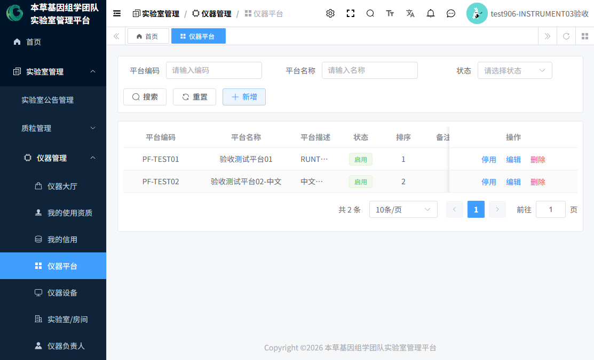

2. 点击右上角「新增」按钮，弹出平台表单。
3. 按下表填写（带 * 为必填）：

| 字段 | 必填 | 填什么 | 示例值 |
|---|:-:|---|---|
| 平台编码 | 是 | 平台的唯一编号，保存后是检索标识 | PF-YYWX-01 |
| 平台名称 | 是 | 平台的显示名称 | 中药药效物质平台 |
| 平台描述 | 否 | 一句话说明平台用途 | 承担药效物质分析类仪器 |
| 排序 | 否 | 数字，越小越靠前，默认 0 | 1 |
| 状态 | 否 | 启用 / 停用，默认启用。**只有"启用"的平台才能被设备关联** | 启用 |
| 备注 | 否 | 补充说明 | — |

4. 点击「确定」保存。列表中出现新行即成功。
5. 常见问题：编码重复会被拒绝，请换一个编码；平台被设备引用后无法删除，只能"停用"。

### 1.2 再建"实验室/房间"

房间是仪器的物理位置。**先建房间，再建设备**——新增仪器时要选择所在房间。

1. 点击「实验室管理 → 仪器管理 → 实验室/房间」，进入房间列表（见 **图18**）。列表中"维修负责人"一列会显示当前生效的维修负责人（姓名+电话），未分配时显示"未分配"——这正是场景 5 要配置的内容。

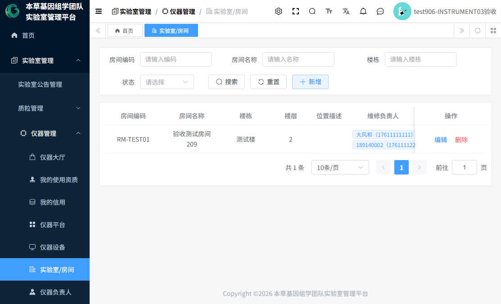

2. 点击「新增」，按下表填写：

| 字段 | 必填 | 填什么 | 示例值 |
|---|:-:|---|---|
| 房间编码 | 是 | 房间唯一编号 | ROOM-209 |
| 房间名称 | 是 | 显示名称 | 209 实验室 |
| 楼栋 | 否 | 所在楼栋 | 药学楼 |
| 楼层 | 否 | 所在楼层 | 2 |
| 位置描述 | 否 | 更细的位置说明 | 东侧走廊尽头 |
| 状态 | 否 | 启用/停用，默认启用。**只有"启用"的房间才能被设备关联** | 启用 |
| 排序 | 否 | 数字，默认 0 | 1 |
| 备注 | 否 | 补充说明 | — |

3. 点击「确定」保存，列表出现新行即成功。
4. 常见问题：房间下已有设备时无法删除，会提示存在引用；此时应改用"编辑 → 停用"。
5. **下一步**：去场景 2 新增仪器。

> 检查点：平台列表、房间列表各多了一行"启用"状态的记录。

---

## 场景 2：新增仪器（设备建档）

**谁来做**：本草基因管理员或租户管理员。
**去哪里**：「实验室管理 → 仪器管理 → 仪器设备」。

1. 进入「仪器设备」列表页（见 **图19**，示例环境已有 3 台设备）。

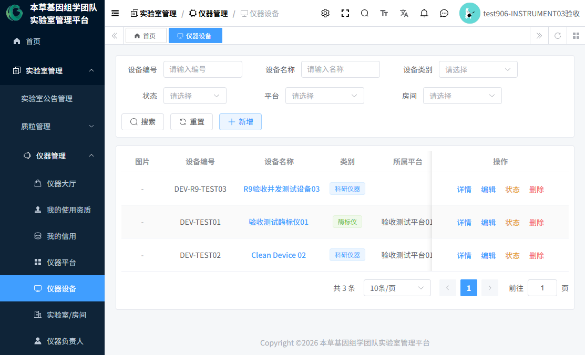

2. 点击「新增」按钮，弹出设备表单（见 **图20**）。

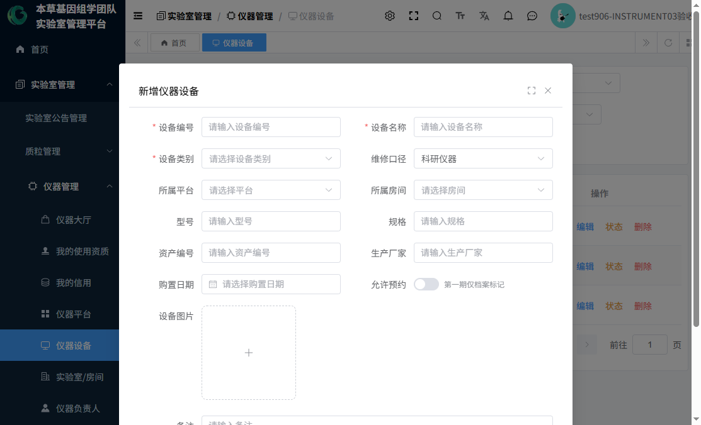

3. 按下表逐项填写（带 * 为必填，其余按实际档案填写，可留空）：

| 字段 | 必填 | 填什么 | 示例值 |
|---|:-:|---|---|
| 设备编号 | 是 | 设备唯一编号 | YQ-2026-001 |
| 设备名称 | 是 | 设备显示名称，列表中点击可进入设备详情 | 全自动酶标仪 |
| 设备类别 | 是 | 下拉选择（字典：酶标仪、离心机等类别） | 酶标仪 |
| 维修口径 | 否 | 维修分类口径，默认"科研" | 科研 |
| 所属平台 | 否 | 下拉，**仅显示"启用"状态的平台**（场景 1 建的） | 中药药效物质平台 |
| 所属房间 | 否 | 下拉，**仅显示"启用"状态的房间**（场景 1 建的） | 209 实验室 |
| 型号 / 规格 / 资产编号 / 生产厂家 | 否 | 按设备铭牌与资产台账填写 | — |
| 购置日期 | 否 | 日期选择 | 2026-01-15 |
| 允许预约 | 否 | 开关。**注意：本期该开关仅作档案标记，设备是否真正开放预约由"预约配置"中的规则启用状态决定**（场景 3） | 开 |
| 设备图片 | 否 | 单张图片上传，会显示在仪器大厅卡片上 | 设备照片 |
| 备注 | 否 | 补充说明 | — |

4. 点击「确定」保存。列表出现新行、状态为"正常"即成功。
5. **重要提醒**（表单编辑态也有同样提示条）：设备的**状态**和**负责人**不在这个表单里修改——状态用列表中的「状态」按钮（场景 12/15），负责人去「仪器负责人」页面（场景 4）。
6. 常见问题：
   - 保存后在大厅看不到设备？→ 检查设备状态是否为"正常"；大厅展示全部状态设备，但不可预约设备按钮是灰的。
   - 平台/房间下拉是空的？→ 场景 1 的平台/房间必须是"启用"状态。
7. **下一步**：场景 3 配置预约规则。

---

## 场景 3：设置预约规则

**谁来做**：**只有本草基因管理员**（租户管理员、设备负责人都没有此菜单）。
**去哪里**：「实验室管理 → 仪器管理 → 预约配置」。

> **核心概念**：一台设备必须配置了**启用的预约规则**才对用户开放预约；系统不预设任何默认值——没配规则 = 不能预约。

1. 进入「预约配置」页面（见 **图27**）。页面顶部是一个"仪器设备"下拉框，先**选择要配置的设备**，下方两个页签都针对这台设备生效。

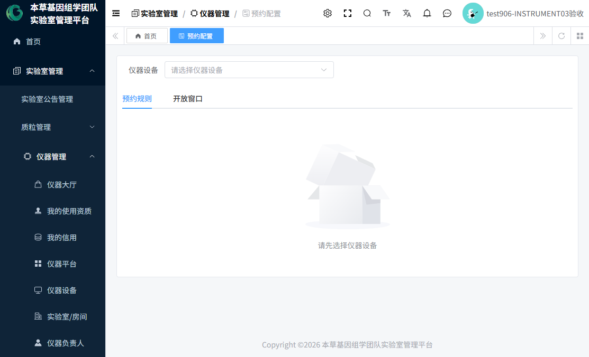

2. **页签一「预约规则」**（每台设备一条），按下表填写：

| 字段 | 必填 | 含义与示例 |
|---|:-:|---|
| 规则启用 | 开关 | 关 = 该设备不开放预约 |
| 时间粒度（分钟） | 启用时必填 | 预约时段按多少分钟切一格，步进 5。示例：**30** |
| 最短预约时长（分钟） | 启用时必填 | 一次预约至少多久。示例：**30** |
| 最长预约时长（分钟） | 选填（须 ≥ 最短） | 一次预约至多多久。示例：**240**（4 小时） |
| 可预约起始偏移（天） | 选填 | 提前 N 天内才可开始约。0 = 当天即可约 |
| 可预约范围（天） | 选填 | 最多可约到未来第 N 天。示例：**7** |
| 每周开放日 | 选填 | 多选周一~周日；**不选 = 每天开放**。示例：勾选周一至周五 |
| 每日开放时段 | 选填 | 起~止时间；**都不填 = 全天开放**。示例：09:00 ~ 18:00 |
| 允许跨天预约 | 开关 | 开启后允许预约跨自然日的时段 |
| 允许开始后管理员调整 | 开关 | 预约开始后是否允许管理侧继续调整 |
| 备注 | 选填 | ≤500 字 |

3. 一个可理解的示例配置：**"工作日 09:00～18:00 开放，每 30 分钟一个预约单位，单次最短 30 分钟、最长 4 小时，最多提前 7 天预约，不允许跨天"** ——对应上表：粒度 30 / 最短 30 / 最长 240 / 偏移 0 / 范围 7 / 开放日勾周一~五 / 时段 09:00~18:00 / 跨天关。
4. 点击保存，规则生效后该设备立即开放预约。
5. **页签二「开放窗口」**（进阶，选配）：
   - 可以给设备配置多条"开放窗口"（窗口名称、每周开放日、时段、目标日期范围、窗口容量等）。
   - 配置了窗口的设备（无论什么类别）走"窗口模式"：预约时段必须**完整落在某一个生效窗口内**（不允许跨窗口），且每个窗口同一时刻容量固定为 1（独占）。
   - 当前开发环境所有设备均未配置窗口（走"规则开放时段"模式），新客户初期可忽略此页签。
6. 常见问题：
   - 用户说"设备显示可预约但选不了时段"？→ 检查规则是否启用、当日是否在开放日/时段内、可预约范围是否覆盖所选日期。
   - 不同设备类别可以用不同规则吗？→ 可以。规则按**设备**逐台配置，每台设备一条，互不影响。
7. **下一步**：场景 4 指定设备负责人。

---

## 场景 4：指定仪器（设备）负责人

**谁来做**：本草基因管理员或租户管理员。
**去哪里**：「实验室管理 → 仪器管理 → 仪器负责人」。

1. 进入「仪器负责人」列表（见 **图21**）。列表同时展示三种授权范围的记录：设备负责人、平台负责人、实验室维修负责人，以及状态（生效中/已解除）。

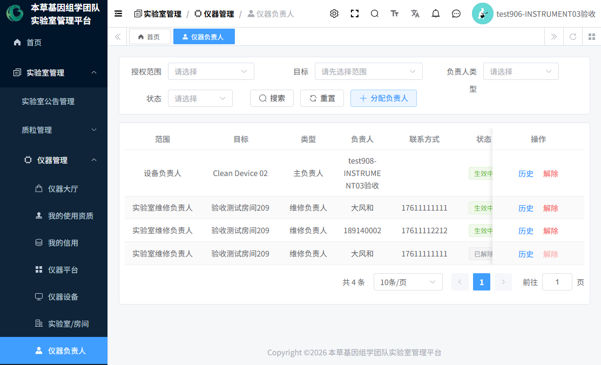

2. 点击「分配负责人」按钮（见 **图22**），按下表填写：

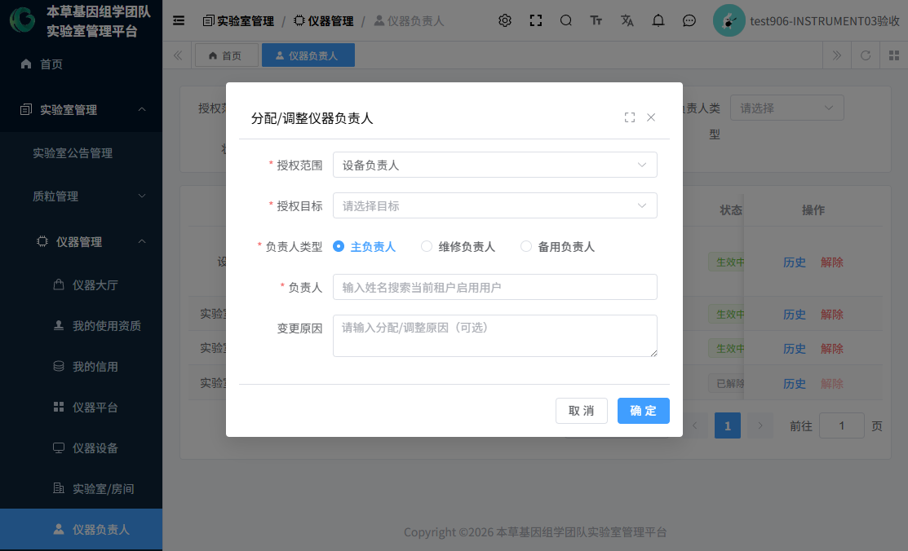

| 字段 | 必填 | 填什么 |
|---|:-:|---|
| 授权范围 | 是 | **设备负责人**（管某台设备）/ **平台负责人**（管某平台下全部设备）/ **实验室维修负责人**（场景 5 用） |
| 目标 | 是 | 随范围联动：选设备则列出设备，选平台列平台，选房间列房间 |
| 负责人类型 | 是 | **主负责人** / **维修负责人** / **备用负责人** |
| 负责人 | 是 | 远程搜索本租户在职用户（显示 姓名/账号/电话） |
| 变更原因 | 选填 | 记录进历史 |

3. 点击「确定」。规则说明（页面有同样提示）：
   - **实验室维修负责人**允许**多名同时生效**；
   - **设备/平台负责人**：同一类型再次分配会**自动解除原负责人**，历史保留可查。
4. 负责人获得什么？→ 被指定为设备负责人的人（须拥有"仪器设备负责人"角色或管理员角色）即可在该设备的"资质审核"中审批申请、在"预约管理"中管理该设备预约（场景 11），并可在信用/暂停模块对该设备的用户执行有限管理动作。
5. 解除负责人：列表中该行「解除」按钮，**解除原因必填**；解除后该人对设备的业务权限立即消失。可点「历史」查看分配/解除全过程时间线。
6. 常见问题：搜不到某个人？→ 该用户可能已被停用，只有启用状态用户可被指定。

---

## 场景 5：指定维修负责人（实验室级）

**谁来做**：本草基因管理员或租户管理员。
**去哪里**：同「仪器负责人」页面。

1. 再次点击「分配负责人」，**授权范围选择"实验室维修负责人"**，目标选择房间（如 209 实验室），负责人类型选择"维修负责人"，选择一名或多名人员。
2. **一间实验室可以同时存在多名有效维修负责人**（系统允许多条同房间维修负责人记录同时"生效中"，实测环境中 209 测试房间即有 2 名生效中的维修负责人）。
3. 配好后回到「实验室/房间」列表，"维修负责人"列会显示姓名和电话。
4. **设备负责人 ≠ 维修负责人**：
   - 设备负责人：对**某台/某平台设备**的资质审批与预约管理负责；
   - 维修负责人：对**某间实验室**的维修事务负责（登记口径在设备/房间档案上）。
5. **维修负责人能做什么**（INSTRUMENT-04 已修复）：
   - ✅ 查看自己负责**房间内全部设备**的资质审核、暂停管理、信用管理列表（数据范围自动过滤）；
   - ✅ 审批自己负责**房间内设备**的资质申请；
   - ❌ 不能修改设备状态（"维护/故障/停用"按钮仅管理员可用）；
   - ❌ 不能配置预约规则（仅管理员可用）。
6. **必须如实告知的重要现状**：当前版本的**维修工单流程尚未上线**——系统已预留维修数据表，但没有维修登记页面、维修工单流转和维修处理操作。设备发生故障时，实际做法是：管理员用设备列表的「状态」按钮把设备置为"故障"或"维护"（场景 12），线下联系维修负责人处理，修好后再把状态改回"正常"。

---

## 场景 6：普通用户申请使用资质

**谁来做**：普通用户（需要用仪器的每一位成员）。
**去哪里**：「实验室管理 → 仪器管理 → 仪器大厅」，或直接进入某台设备的详情页。

1. 登录后进入「仪器大厅」：顶部按平台切换页签，支持按实验室（房间）、类别、状态、名称筛选；每台设备一张卡片，显示状态标签、类别、图片、名称、编号、平台/房间、负责人（见 **图4、图5**）。


2. 点击卡片上的「申请资质」按钮（或先点卡片进入设备详情页，再点右上角「申请资质」）。
3. 弹出申请弹窗（见 **图8**）：显示申请设备名称，"申请理由"为**选填**（≤1000 字），写清楚为什么需要用这台仪器即可。


4. 点击「提交申请」，提示"资质申请已提交，请等待授权负责人审核"。
5. 查看进度：
   - 设备详情页"我的使用资质"区域会显示"审核中"+ 申请单号，并提供「撤回申请」按钮；
   - 或进入「我的使用资质」页面，上区显示已生效资质，下区显示全部申请记录与审核意见（见 **图10**）。


6. 撤回：待审核状态的申请可点「撤回申请」，确认后撤回，**撤回后不可恢复**（如仍需要，重新提交即可）。
7. 常见问题：
   - 「申请资质」按钮看不到？→ 您的角色没有资质申请权限，请联系管理员。
   - 重复申请会怎样？→ 已有"生效中"资质或"待审核"申请时无需再申请。

---

## 场景 7：审批资质（通过后发生什么）

**谁来做**：本草基因管理员、租户管理员，或**该设备的负责人**（拥有"仪器设备负责人"角色且与设备建立了负责人关系）。
**去哪里**：「实验室管理 → 仪器管理 → 资质审核」。

1. 进入「资质审核」页面，默认在"申请审核"页签（见 **图24**）。可按状态（待审核/已通过/已驳回/已撤回）和设备筛选。

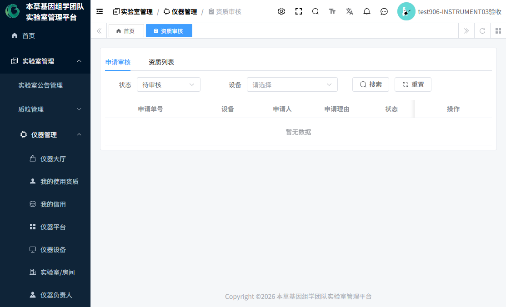

2. 找到待审核的申请，点击「审核」，弹窗中选择：
   - **审核结果**：通过 / 驳回（必选）；
   - **有效期至**：仅"通过"时显示，**不填 = 长期有效**；
   - **审核意见**：**驳回时必填**（≤500 字），通过时可选填；
   - 备注：选填。
3. 点击确定完成审批。被驳回的申请，用户可在"我的使用资质"看到驳回意见，重新提交后进入下一轮审核。
4. **通过后系统自动发生三件事**：
   - 该用户获得该设备的"生效中"使用资质；
   - **如果是该用户第一次获得任意仪器资质，系统自动为其开通信用账户，初始信用分 100 分**（已有账户则不重复创建、不重置、不加分）；
   - **如果该用户之前对同一设备有"已暂停"资质**（比如之前被暂停使用过，暂停又解除了），系统会**恢复旧资质的"已暂停"状态为"生效中"，而不会创建一条新的重复资质**（避免同用户同设备两条"生效中"资质记录，INSTRUMENT-04 修复）。
5. **暂停覆盖与资质恢复的安全逻辑**：如果用户资质是因为"暂停"被置为"已暂停"，审批通过时若该暂停已解除 → 恢复"生效中"；若暂停仍在生效 → 旧资质保持"已暂停"状态（暂停继续生效）。不会产生重复资质。
6. 在"资质列表"页签可查看全部资质（状态：生效中/已到期/已暂停/已撤销）。**"生效中"的资质可被撤销**（「撤销」按钮，撤销原因必填）；撤销后用户立即失去该设备的预约资格。
7. 常见问题：
   - 设备负责人看不到某条申请？→ 您不是该设备的负责人，或负责人关系已被解除。
   - "已到期"状态说明什么？→ 审批时填写了"有效期至"且已过期的展示态。**当前版本没有自动到期处理**，到期不联动任何业务限制，需要时由管理员人工撤销。

---

## 场景 8：普通用户预约仪器

**前提**：① 拥有该设备"生效中"资质；② 设备预约规则已启用；③ 预约创建开关已开启（当前环境已开启）；④ 用户未处于"使用暂停"覆盖范围；⑤ 设备状态为"正常"。
**去哪里**：「仪器大厅」卡片上的「立即预约」，或设备详情页右上角「立即预约」。

1. 在「仪器大厅」找到目标设备，点击「立即预约」（见 **图4**）。若按钮是灰色，说明该设备未开放预约（鼠标悬停提示"该设备未开放预约"）。
2. 弹出预约弹窗（见 **图9**）：


3. 按顺序操作：
   1. **选择预约日期**（只能选今天及以后；超出可预约范围天数的日期会被服务端规则拦下）。
   2. 页面显示"**当日开放范围**"（如 09:00 ~ 18:00）——若显示"当日无开放时段"，换一天或联系管理员检查规则。
   3. 在"**可预约时段**"网格中**先点一个绿色槽位作为开始时间，再点另一个作为结束时间**（结束为右开区间，即 09:00~10:00 表示用到 10:00 整）。灰色的槽位不可选，悬停可看到不可约原因；"当日占用"区域列出了已被预约/维护占用的时段。
   4. 下方自动回显**开始时间、结束时间、时长**；填写**用途**（选填，≤200 字）和**备注**（选填，≤500 字）。
   5. 点击「确认预约」。提示"预约提交成功，可在「我的预约」查看"。
4. 预约号规则：**R + 日期 + 5 位流水**（如 R2026102000007）。同一设备同一时段**独占**（容量恒为 1），别人已约的时段您选不了。
5. 到「我的预约」查看记录（见 **图12**）：列表显示预约号、设备、预约时间、时长、状态（待生效/已完成/已取消/已作废）、用途、创建时间。**注意：「我的预约」页面没有"新建"按钮**，新预约只能从仪器大厅/设备详情发起。


6. 提交失败常见原因（提示文案会直接告诉您原因）：

| 现象 | 原因 | 处理 |
|---|---|---|
| 错误码 116，"功能未开放" | 预约创建开关被关闭 | 联系系统负责人开启 |
| 未持有生效资质 | 资质未审批或已暂停/撤销 | 先完成场景 6/7 |
| 用户处于暂停中 | 被暂停使用（见场景 13） | 联系管理员解除 |
| 设备不在正常状态 | 设备故障/维护/停用中 | 等待状态恢复 |
| 所选时段包含不可预约时段 | 与已有预约/维护占用冲突 | 换时段 |
| 不在开放时段/超出可约范围 | 规则限制 | 按规则选择 |

---

## 场景 9：调整与取消预约

**谁来做**：预约人本人，或管理侧（负责人/管理员）。
**去哪里**：「我的预约」（本人操作）或「预约管理」（管理侧操作）。

### 9.1 本人取消
1. 进入「我的预约」，找到**待生效（未开始）**的预约，点「取消」。
2. 本人取消时取消原因**选填**；确认后预约状态变为"已取消"，记录保留、时段立即释放。
3. **时间限制：本人只能在预约开始前取消**；预约已开始则本人无法取消，需联系负责人/管理员。

### 9.2 本人调整
1. 在「我的预约」对待生效预约点「调整」。
2. 可修改**开始/结束时间**，也可**更换设备**（下拉仅列出"正常"状态的其他设备）。
3. 保存时系统对您重新做全套校验（资质、暂停、设备状态、开放时段、时段冲突），任一不通过则调整失败、原预约保持不变。
4. 同样仅限**开始前**调整。

### 9.3 管理侧取消/调整
负责人或管理员在「预约管理」中对预约执行取消/调整，**管理侧取消或调整时原因必填**；管理侧不受"开始前"限制。

---

## 场景 10：管理员管理预约（完成 / 作废 / 历史）

**谁来做**：本草基因管理员（租户管理员没有预约管理菜单）。
**去哪里**：「实验室管理 → 仪器管理 → 预约管理」。

1. 进入「预约管理」列表（见 **图28**）。页面顶部说明数据范围："本人预约或本人负责/管理设备下的预约"；管理员可见全部。可按预约单号、设备、状态筛选。

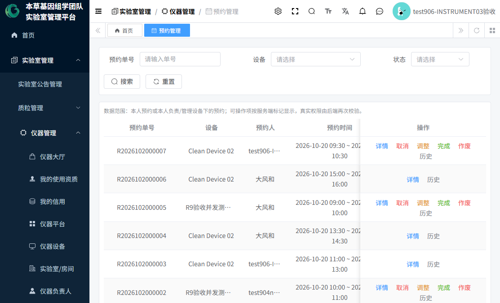

2. 每行按钮随状态与您的身份自动变化：
   - **详情**（见 **图29**）：查看预约号、设备、预约人、预约时间、时长、用途、备注、创建时间；已取消的显示取消时间/取消方（本人/负责人/管理员）/取消原因；已完成的显示完成时间与实际使用起止；已作废的显示作废时间与原因。

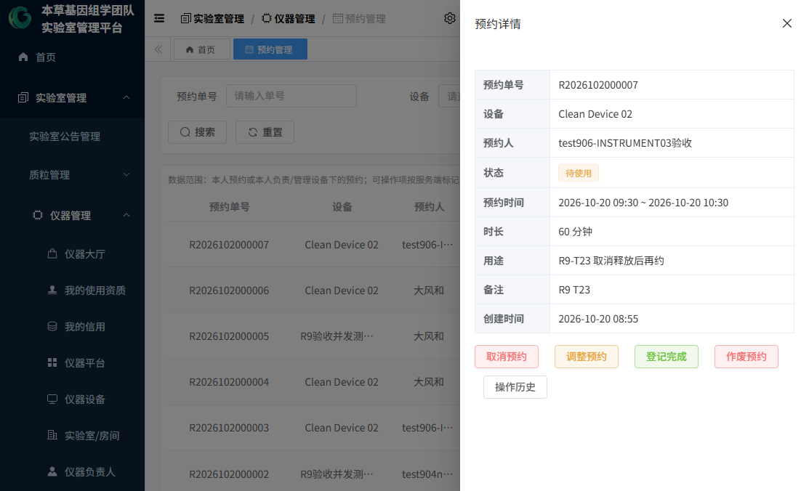

   - **完成**：对待生效预约登记"实际使用"——**实际开始时间、实际结束时间必填**（结束须晚于开始），备注选填。**系统没有任何自动完成机制**，用没用完都需要人来登记。
   - **作废**：对待生效预约执行管理侧作废——**作废原因必填**，需二次确认；作废后不占时段、不可恢复。
   - **历史**：查看该预约的全部动作时间线（创建/调整/取消/完成/作废、操作人、原因，见 **图29b**）。

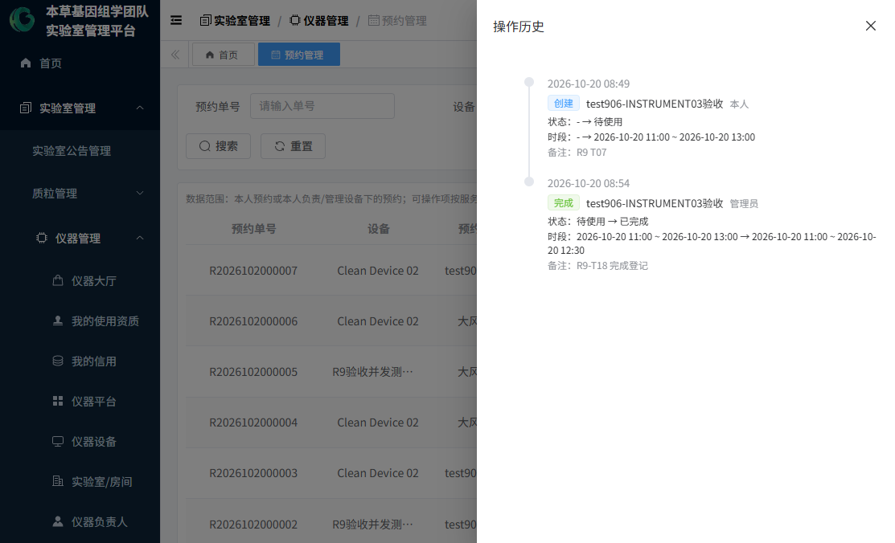

3. 操作建议：实际使用完毕 → 「完成」登记实际起止；约了没用或录入错误 → 「作废」并写明原因。

---

## 场景 11：设备负责人管理预约

**谁来做**：拥有"仪器设备负责人"角色、且被指定为设备/平台负责人的用户。
**入口**：「预约管理」「资质审核」两个菜单。

1. 负责人登录后打开「预约管理」，只会看到**自己负责设备**上的预约（以及自己的预约），看不到其他设备的预约。
2. 对这些预约可执行与场景 10 相同的取消/调整/完成/作废操作（原因规则相同）。
3. 「资质审核」中只能审批自己负责设备的资质申请。
4. **边界**：
   - 不能配置预约规则（无"预约配置"菜单）；
   - 不能查看或管理未授权设备的数据；
   - 负责人关系被解除后，上述数据立即不可见、按钮立即失效。
5. 角色与业务关系缺一不可：只有角色没有关系 → 菜单在但列表为空；只有关系没有角色 → 连菜单都看不到。

---

## 场景 12：仪器故障及维修

**当前实现状态（如实说明）**：
- 设备**状态流转**已实现：管理员可通过「状态」按钮在 正常/维护/故障/停用 之间流转；
- **维修工单流程未上线**：没有故障登记页面、没有维修任务分派、没有维修处理操作，系统仅预留了数据表。请勿在系统中寻找"维修工单"功能。

**实际操作流程（谁来做：本草基因管理员/租户管理员）**：

1. 进入「仪器设备」列表，找到故障设备，点击行内「状态」按钮。
2. 弹出"设备状态管理"弹窗，单选目标状态：
   - **正常**：可正常预约使用；
   - **维护**：维护期间不可预约（如定期保养）；
   - **故障**：设备坏了，不可预约；
   - **停用**：人为停用，不可预约；停用状态才可进入报废或删除；
   - **报废**：**终态**，只有"停用"状态的设备才能选"报废"（弹窗内有提示文案），报废后不可再流转。
3. 设备进入"故障/维护"后，仪器大厅卡片状态标签同步变化，预约弹窗中该时段按占用处理，用户无法再预约。
4. **线下维修**：联系该房间的维修负责人（房间列表"维修负责人"列可查到姓名电话）处理。
5. 修复后：管理员再点「状态」→ 选"正常"，设备恢复可预约。
6. 状态对资质的影响：设备状态变化**不影响**已有资质记录；但非"正常"状态的设备无法提交新预约。

**正常 → 故障 → 维护 → 恢复正常** 的状态机示意：

```
             ┌────────────（修复/保养完成）────────────┐
             ▼                                        │
 正常 ──► 故障 ──► 维护 ──► 停用 ──► 报废（终态，不可逆）
   ▲        │        │        │
   └────────┴────────┴────────┘  各非报废状态可互相流转；
                                   仅"停用"可进入"报废"；同状态重复设置自动忽略
```

---

## 场景 13：暂停用户使用资格

**谁来做**：本草基因管理员/租户管理员可暂停任意范围；设备/平台负责人仅可暂停其授权设备的用户。
**去哪里**：「实验室管理 → 仪器管理 → 暂停管理」。

1. 进入「暂停管理」列表（见 **图26**），列显示用户、范围（单仪器/全部仪器）、设备、状态（暂停中/已解除/已到期）、原因、起止时间、解除信息等。

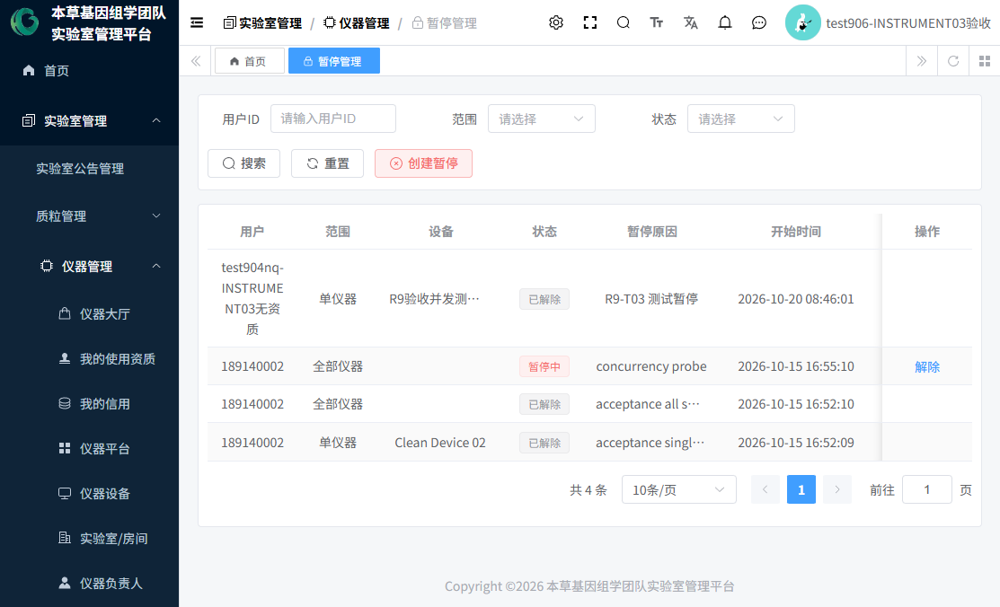

2. 点击「创建暂停」，填写：

| 字段 | 必填 | 说明 |
|---|:-:|---|
| 目标用户 | 是 | 远程搜索本租户在职用户 |
| 暂停范围 | 是 | **单仪器**（须再选设备）/ **全部仪器**（仅管理员可创建） |
| 暂停时长 | 是 | **两选一**：预设档位（1/3/7/14/30 天）或 自定义"计划结束时间"；两者同时填或都不填都会被拒绝 |
| 暂停原因 | 是 | ≤500 字，必填 |
| 备注 | 选填 | — |

3. **生效规则（重要）**：
   - 创建后**立即生效**：暂停中的用户在对应范围内**无法提交新预约**；
   - 创建暂停的同一时刻，系统把该用户**当时生效中的资质**自动置为"已暂停"（暂停全部 = 全部资质；暂停单仪器 = 该设备资质）；
   - **解除后**，只有"当前没有其他生效中暂停覆盖"的已暂停资质会自动恢复。
4. 解除：列表中「解除」按钮（仅"暂停中"状态可点），**解除原因必填**。
5. **必须如实告知**：**到达"计划结束时间"不会自动解除**——当前版本按"人工解除"设计，到期自动处理的定时任务代码已保留但未启用。到点后请管理员人工解除；"我的信用"页面的暂停记录区也有同样提示。
6. 对预约的影响：暂停不影响已有预约记录，只拦截**新预约**；如需处理已有预约请用取消/作废。

---

## 场景 14：信用管理

**信用分是什么**：每位用户**第一次通过任意仪器资质审批**时自动开通信用账户，**初始 100 分**。信用分只是一个人为登记的信用档案：**系统没有任何自动扣分、自动停用规则**，分数变动全部由管理员/负责人手工登记，分数可以超过 100 也可以为负，**信用分本身不自动限制仪器使用**。

### 14.1 普通用户查看自己的信用
「实验室管理 → 仪器管理 → 我的信用」（见 **图11**）：信用分卡片 + 信用说明 + 本人积分流水 + 我的暂停记录。


### 14.2 管理员调整信用分
**去哪里**：「信用管理」（仅管理员/负责人有菜单）。
1. "信用账户"页签（见 **图25**）：显示每个用户的当前信用分（低于 80 红色、低于 100 黄色）、激活状态、最近变动。点击「加扣分」：

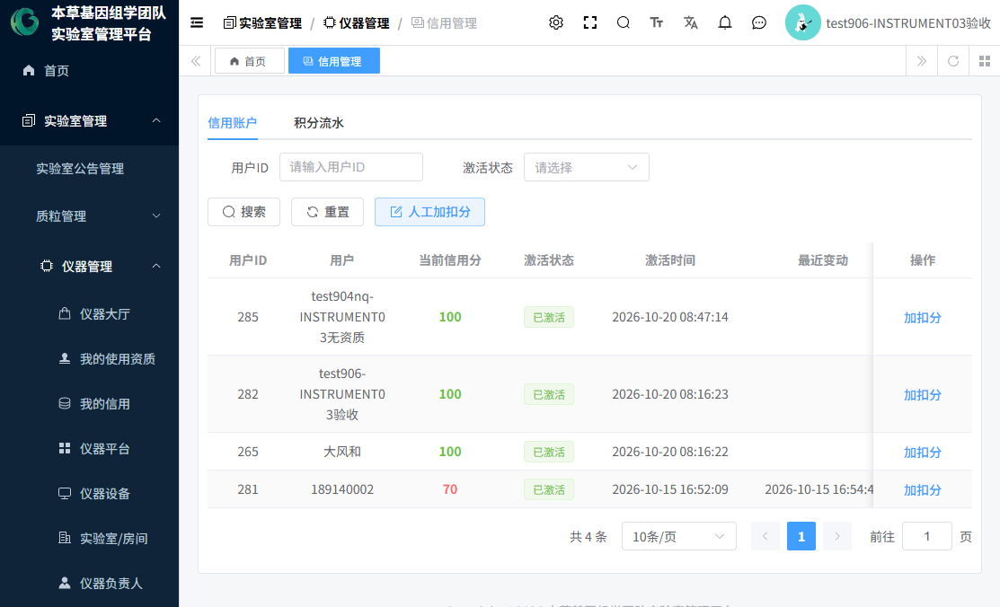

| 字段 | 必填 | 说明 |
|---|:-:|---|
| 目标用户 | 是 | 远程搜索 |
| 变动值 | 是 | 正数=加分，负数=扣分，**不能为 0**；无上下限、允许负分 |
| 原因类型 | 是 | 违规/超时/奖励/手工（默认"手工"） |
| 变动原因 | 是 | 必填，写入流水留痕 |
| 备注 | 选填 | — |

2. "积分流水"页签：全部变动留痕（变动前后分数、原因、操作人、时间），支持导出 Excel；**流水不可修改、不可删除**。
3. 权限边界：账户/流水列表仅管理员可查；设备/平台负责人只能对"在其授权设备上持有生效资质的用户"调分。
4. 低分怎么办：**没有自动处理**。如需限制某人使用，请使用场景 13 的"暂停"。

---

## 场景 15：仪器停用、报废

**谁来做**：本草基因管理员/租户管理员。**去哪里**：「仪器设备」列表「状态」按钮。

| 目标状态 | 怎么进入 | 对预约的影响 | 对资质的影响 | 后续可能 |
|---|---|---|---|---|
| 停用 | 状态按钮选择"停用" | 不可新预约 | 资质保留但设备不可用 | 可恢复"正常"，或进入"报废"，或删除档案 |
| 报废 | **只有"停用"状态才能选"报废"** | 不可预约（终态） | 资质对报废设备已无意义，可由管理员撤销 | 不可再流转任何状态；档案可删除 |
| 删除档案 | 列表「删除」按钮 | — | — | **仅"停用/报废"状态的设备可删除**，且须先解除该设备全部"生效中"的负责人关系 |

> 实测环境示例：设备"验收测试酶标仪01"当前即为报废状态，仪器大厅可见其状态标签，但无法预约。

---

## 附 A：当前开发环境实测数据（2026-10-20，供验收对照）

| 设备 | 编号 | 状态 | 预约规则 | 负责人 | 备注 |
|---|---|---|---|---|---|
| 验收测试酶标仪01 | DEV-TEST01 | 报废 | 无 | — | 不可预约 |
| Clean Device 02 | DEV-TEST02 | 正常 | 已启用（30 分钟粒度/工作日 09:00-18:00/最长 4 小时/提前 7 天） | test908（主负责人） | 可预约 |
| R9验收并发测试设备03 | DEV-R9-TEST03 | 正常 | 已启用（同上） | — | 可预约 |

- 平台：验收测试平台01、验收测试平台02-中文；房间：验收测试房间209（测试楼 2 层），维修负责人 2 名生效中。
- 使用须知：2 条（挂在设备 1 下）。
- 预约记录：R2026102000001 ~ R2026102000007 共 7 条。
- 详细的可测试性说明见《10-当前开发环境可测试功能与限制》。

## 附 B：术语速查

| 术语 | 含义 |
|---|---|
| 平台 | 仪器的业务归属单位（按研究方向划分） |
| 房间/实验室 | 仪器的物理位置，维修负责人挂靠在房间上 |
| 使用资质 | 某用户对某台设备的授权使用凭证（生效中/已到期/已暂停/已撤销） |
| 预约规则 | 每台设备一条的预约开放规则（粒度/时长/开放日/时段等） |
| 开放窗口 | 选配的进阶预约模式（按窗口开放，容量固定 1） |
| 信用账户 | 首次资质通过时自动开通的信用档案（初始 100 分） |
| 暂停 | 拦截用户新预约的管理手段（单仪器/全部仪器） |
| C7 开关 | "预约创建"功能总开关，由系统负责人在后端配置控制，默认关闭，**当前环境为开启** |

---

*编制日期：2026-10-20 ｜ 核验依据：前后端源码 + 租户 162 数据库实查 + 实际页面截图 ｜ 未实现功能（维修工单、暂停自动到期、资质自动到期、使用须知确认环节等）详见《11-文档核验与未实现功能清单》。*
