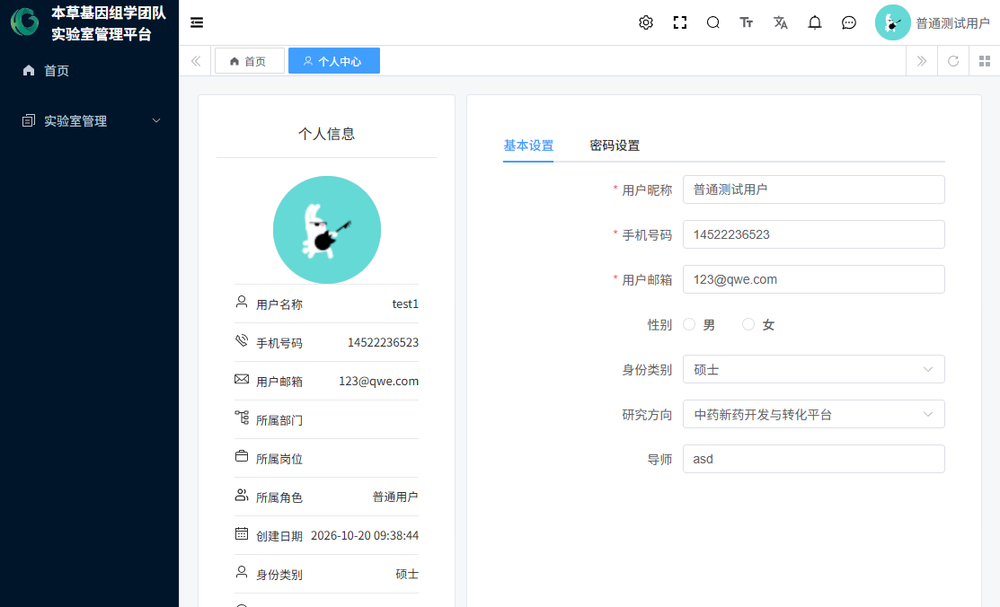
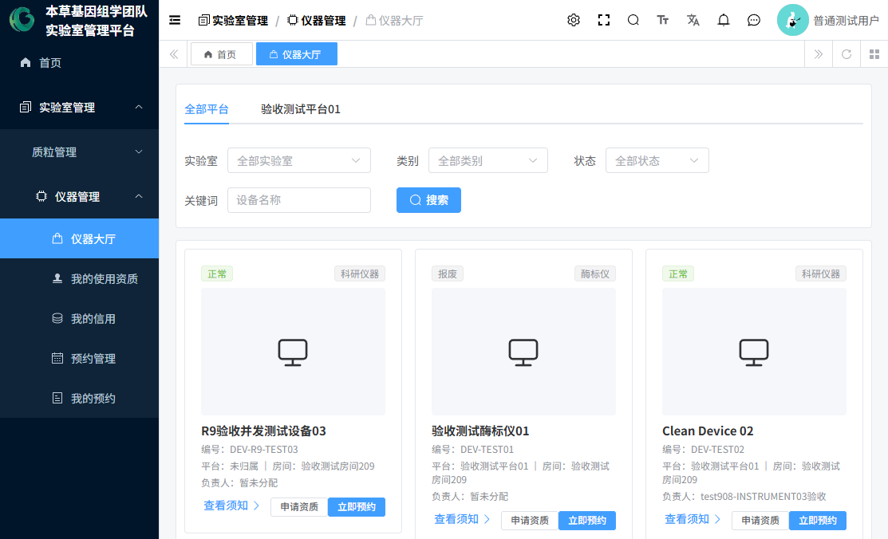
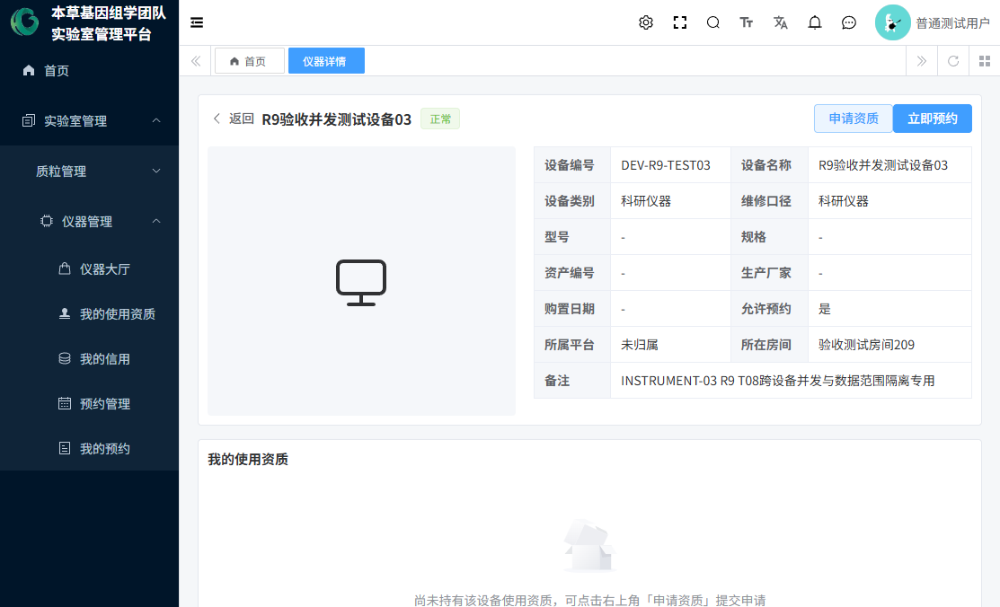
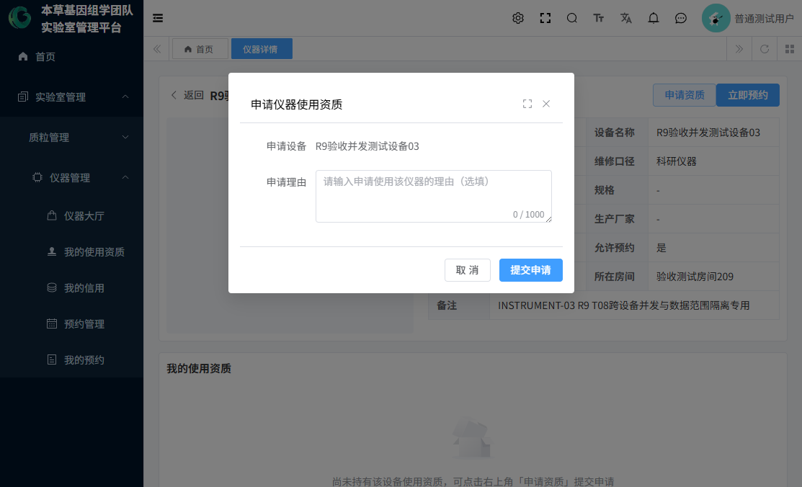
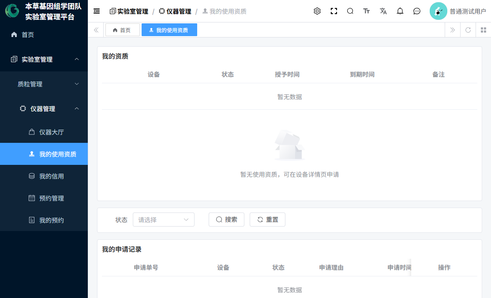
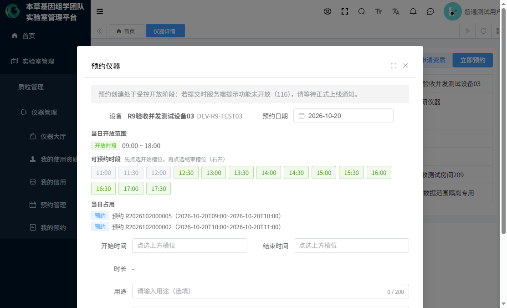
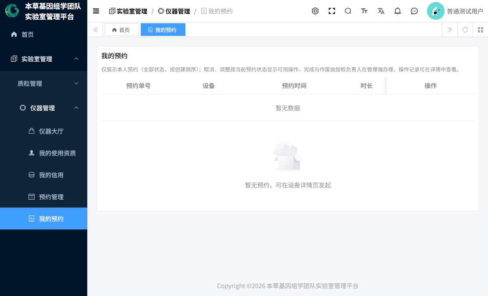
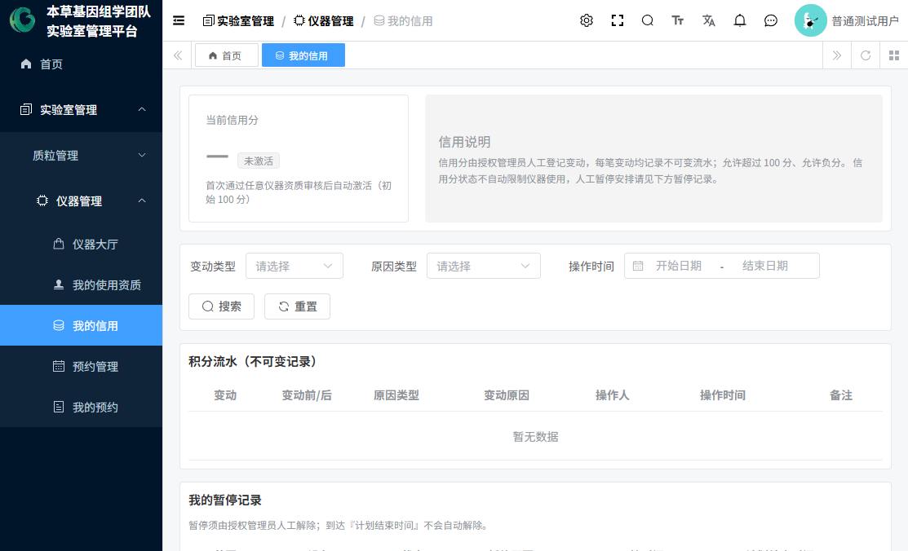

# 03 普通用户操作指南

> 本指南面向实验室普通成员（角色"普通用户"，注册审批通过后自动获得）。
> 普通用户的日常就是四件事：**管好自己的账号 → 申请资质 → 预约仪器 → 借还质粒**。
> 编制日期：2026-10-20 ｜ 全部操作按当前实际系统核验。

---

## 1. 登录与个人信息

### 1.1 登录
1. 打开系统地址，输入用户名（学号/工号）和密码登录（见 **图1**）。
2. 忘记密码：请联系管理员在"用户管理"中重置（当前版本未提供自助找回）。

### 1.2 个人中心
右上角头像 → 「个人中心」（见 **图15**）：
- **基本信息**：可修改昵称、手机号、邮箱、性别；身份类别/研究方向/导师等注册信息也可在此查看与修改。手机号、邮箱直接保存生效（无验证码环节）。
- **上传头像**：本地选图、裁剪、上传。
- **重置密码**：输入旧密码和新密码即可修改。



## 2. 浏览仪器：仪器大厅与设备详情

1. 菜单「实验室管理 → 仪器管理 → 仪器大厅」（见 **图4**）。
   - 顶部页签按平台切换；可按实验室（房间）、类别、状态、名称筛选。
   - 每张卡片显示：状态标签、类别、图片、设备名称、编号、平台、房间、负责人。
2. 点击卡片进入**设备详情**（见 **图6、图7**）：
   - 设备完整档案（编号、类别、维修口径、型号、规格、资产编号、生产厂家、购置日期、所属平台/房间等）；
   - "我的使用资质"：您在该设备的资质状态（生效中/审核中/无）；
   - "当前负责人"：主负责人姓名、账号、联系方式——遇到问题找他们；
   - "使用须知"：当前生效版本的须知全文，**使用前请仔细阅读**。






## 3. 申请使用资质

**没有资质就不能预约。** 第一次使用某台仪器，先申请资质：

1. 在仪器大厅点「申请资质」，或进入设备详情点右上角「申请资质」。
2. 弹窗中填写申请理由（选填，建议写明实验用途），点「提交申请」（见 **图8**）。



3. 提交后状态为"审核中"。查看与撤回：
   - 设备详情"我的使用资质"区域显示审核中单号，可「撤回申请」（撤回后不可恢复，需要再申请重新提交）；
   - 或菜单「我的使用资质」查看全部申请记录与审核意见（见 **图10**）。
4. 审批通过后：详情页显示"生效中"资质；**首次通过任意资质时系统自动为您开通信用账户（100 分）**。



## 4. 预约仪器

### 4.1 发起预约
1. 前提自查：资质生效中 ✔ 设备状态"正常" ✔ 未被暂停 ✔ 预约创建开关开启（当前环境已开启）✔
2. 仪器大厅点「立即预约」（灰按钮 = 该设备未开放预约）。
3. 预约弹窗（见 **图9**）：
   1. 选预约日期（今天起，最多可约天数以设备规则为准）；
   2. 看"当日开放范围"；
   3. 在时段网格中**先点开始槽位、再点结束槽位**（绿色可选、灰色不可选，悬停看原因）；
   4. 填用途（选填）、备注（选填）；
   5. 点「确认预约」，提示成功。



4. 预约号规则：R+日期+5 位流水（如 R2026102000007）。时段独占，先约先得。

### 4.2 查看我的预约
菜单「我的预约」（见 **图12**）：全部状态按创建倒序；**本页没有新建按钮**，新预约一律从大厅/详情发起。



### 4.3 调整预约
- 仅**待生效（未开始）**的预约可调整。
- 「调整」弹窗中可改起止时间，也可**更换设备**（仅"正常"状态设备）。
- 保存时系统重新校验资质/暂停/设备状态/开放时段/冲突，任一不通过则保持原预约。

### 4.4 取消预约
- 仅**开始前**可本人取消；取消原因选填。
- 已开始的预约本人无法取消/调整，请联系设备负责人或管理员（管理侧取消时需填原因）。

### 4.5 查看预约状态与历史
- 状态含义：待生效 / 已完成（负责人登记了实际使用）/ 已取消 / 已作废。
- 「详情」看预约信息与结果；「历史」看每一步操作记录。

## 5. 我的信用与暂停

- 菜单「我的信用」（见 **图11**）：
  - 信用分卡片：首次资质通过时开通，初始 100 分；
  - 积分流水：每一笔加分/扣分的记录（谁操作、什么原因）；
  - 我的暂停记录：若被暂停，这里能看到范围、原因、起止时间和解除信息。
- 信用说明要点：分数变动均为人工登记；可以超过 100 或为负；**信用分本身不会自动限制您使用仪器**（若被限制，会是通过"暂停"）。



- 若您提交预约时提示"处于暂停中"：请查看「我的信用 → 我的暂停记录」了解原因，联系管理员解除。

## 6. 质粒个人业务

普通用户在质粒模块可做四件事：**登记质粒、申请借用、申请归还、查询自己的记录**。

### 6.1 登记质粒
1. 菜单「实验室管理 → 质粒管理 → 质粒库」→「新增」。
2. 按表单填写：质粒编号（手填、唯一、创建后不可改）、名称、受体、物种、抗性、载体、荧光标签、突变/修饰/标签、质粒类型、保存信息（保存形式、浓度、原始位置、序列图谱文件或无文件原因二选一、初始库存申报——**提交审核前必填**）。
3. 保存后为"草稿"，核对无误点「提交审核」。之后由该类型的库管员现场核查审批。

### 6.2 申请借用
1. 菜单「质粒借用」→「申请借用」：选质粒、填申请数量(μL)、借用原因（必填）、应归还时间、归还类型（五选一，选"其他"必须写说明）。
2. 提交后等待库管员审核；**审核通过的那一刻系统自动按批准数量出库**。
3. 待审核状态可「取消」自己的申请。
4. 若提示"当前处于借用限制状态"：您在借用黑名单中，请联系库管员。

### 6.3 申请归还
1. 菜单「质粒归还」→「申请归还」：选择本人可归还的借用单（显示已还进度）、归还类型、计划归还数量（不能超过剩余应还）。
2. 库管员确认实际收到数量后自动入库；全部还清后借用单自动完成。

### 6.4 查询
「质粒库」列表只显示本人创建的或已审核通过的质粒；「质粒借用」「质粒归还」列表普通用户只能看到自己的单据。

## 7. 普通用户不能做什么（权限边界，实测）

- 不能审批他人的资质申请（无资质审核菜单）；
- 不能创建/修改/删除设备、平台、房间、使用须知、预约规则；
- 不能管理他人的预约（「预约管理」菜单打开只显示您自己的数据，且没有"完成/作废"按钮）；
- 不能调整他人信用分、不能创建/解除暂停；
- 不能审核质粒、不能做库存出入库/盘点、看不到违规/黑名单/存放位置页面；
- 不能修改质粒类型（只读）；
- 看不到用户管理、角色管理、注册审批等管理菜单。

## 8. 常见问题（FAQ）

| 问题 | 原因与处理 |
|---|---|
| 看不到"立即预约"或按钮灰色 | 设备未开放预约（未配启用规则或档案标记关闭），联系管理员 |
| 提交预约报错误码 116 | 预约创建开关被系统负责人关闭，等待开启 |
| 提交预约提示无资质 | 先走第 3 节申请资质 |
| 提交预约提示"暂停中" | 查看"我的信用 → 我的暂停记录"，联系管理员 |
| 预约提交成功但在"我的预约"看不到 | 刷新页面；预约按创建时间倒序排列 |
| 资质申请被驳回 | 在"我的使用资质"查看驳回意见，修改理由后重新提交 |
| 想换预约时间但已开始 | 本人无法再调整，联系设备负责人/管理员 |
| 忘记密码 | 联系管理员重置 |

## 9. 一次完整使用的推荐路径

```
登录 → 仪器大厅找到仪器 → 读使用须知 → 申请资质 → 等待审批
    → （通过后）立即预约选时段 → 到时间使用仪器
    → 需要变更就调整/取消 → 使用完成后负责人会登记完成
    → 随时可在"我的预约/我的信用"查看记录
```

---

*编制日期：2026-10-20 ｜ 本指南描述普通用户角色实测权限；管理员操作见《04-本草基因管理员操作指南》。*
