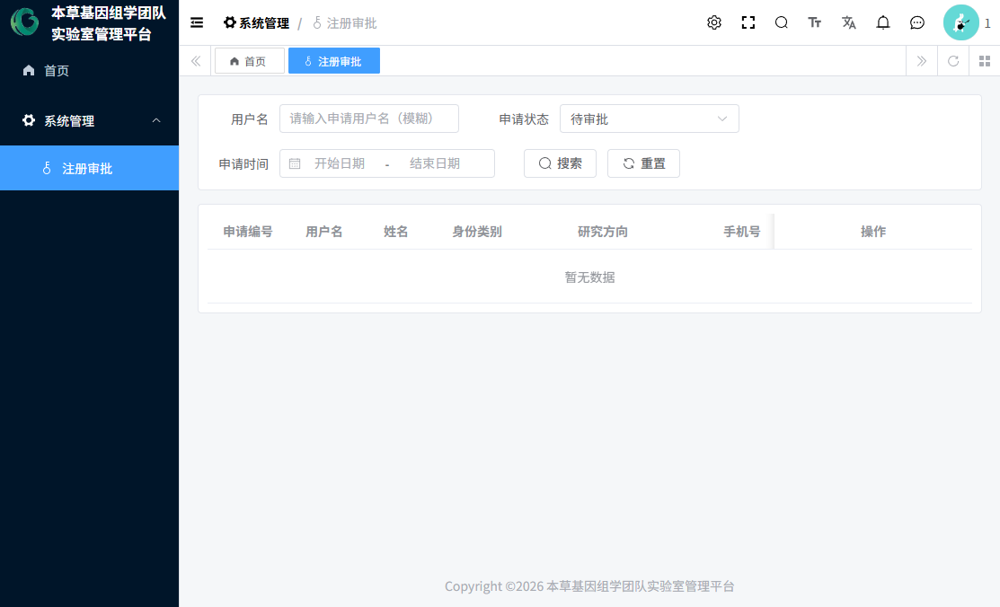
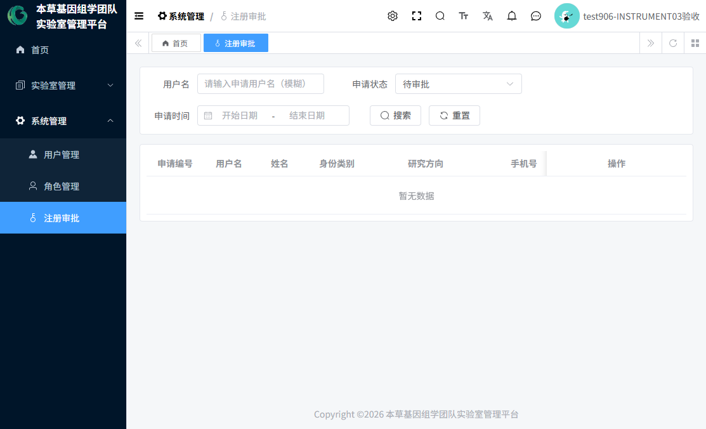
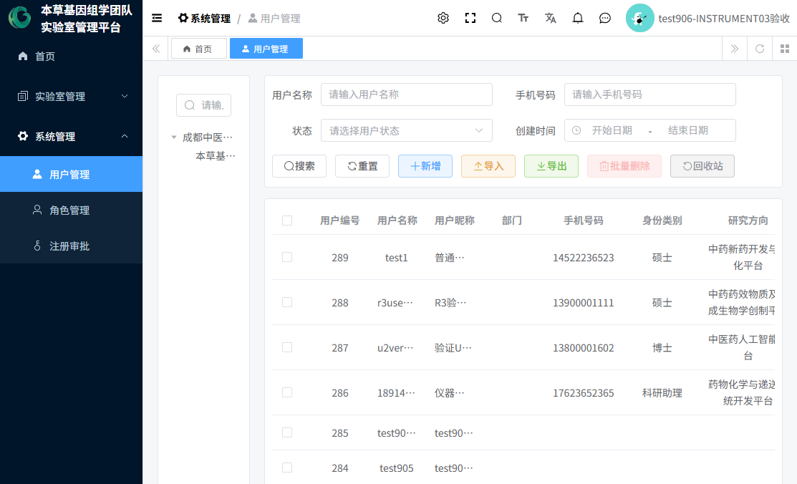
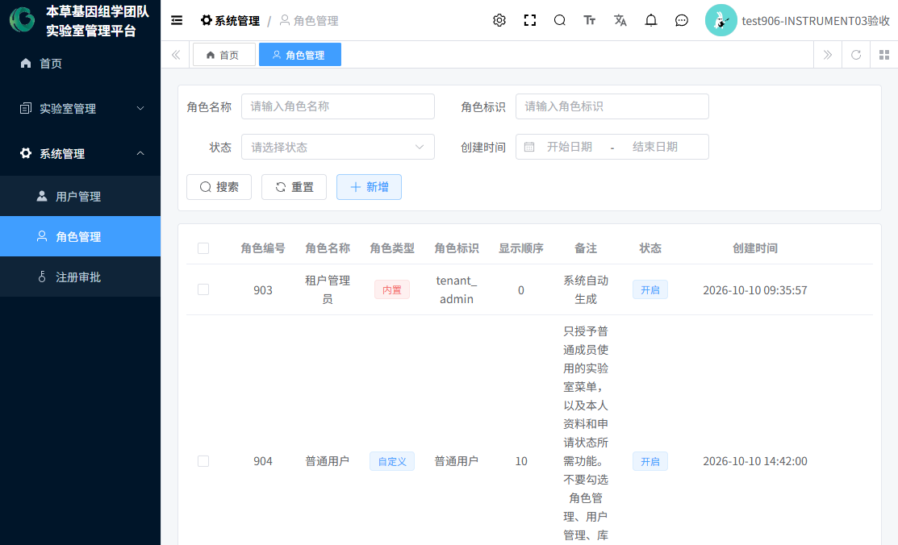

# 06 注册审批与用户管理指南

> 本指南覆盖三块内容：**新用户如何申请注册**、**审批专员/管理员如何审批**、**管理员如何维护用户与角色**。
> 适用角色：注册审批专员（专职审批）、本草基因管理员、租户管理员，以及所有新成员。
> 编制日期：2026-10-20 ｜ 全部流程按当前实际系统核验。

---

## 1. 新用户申请注册（无需登录）

### 1.1 入口
1. 打开登录页（见 **图1**），点击右下角「注册」按钮，进入"注册申请"页面（见 **图2**）。
2. 该页面**无需登录**即可访问。

### 1.2 填写申请（页签一：提交申请）

| 字段 | 必填 | 规则 |
|---|:-:|---|
| 所属租户 | 是 | 默认预填"成都中医药大学"，一般不用改 |
| 用户名（学号/工号） | 是 | 4-30 位，仅字母和数字 |
| 密码 / 确认密码 | 是 | 4-16 位，两次一致；**请牢记：审批通过后就用它登录** |
| 姓名 | 是 | ≤30 字 |
| 手机号 | 是 | 11 位大陆手机号 |
| 邮箱 | 是 | 合法邮箱格式 |
| 身份类别 | 是 | 硕士 / 博士 / 博士后 / 科研助理 / 教师 |
| 研究方向 | 是 | 固定七个平台选项之一（不接受自填文字） |
| 导师 / 指导教师 | 条件必填 | **硕士、博士、博士后必填**；科研助理、教师选填 |
| 入学/入职开始年月、结束年月 | 是 | 年月选择 |
| 申请理由 | 否 | ≤500 字 |

3. 点击提交，提示"注册申请已提交，请等待管理员审批"。
4. **用户名规则**：提交后用户名即被"占用"——同用户名的待审批申请不能重复提交；已驳回的申请保留占用；审批通过后占用转为正式账号。**被驳回或被删除的用户名不会自动释放，不能被他人或本人重新以"新申请"方式使用**（如确需释放请联系管理员处理数据）。
5. 注册页**没有验证码**（防刷依赖用户名占用约束与人工审批）。

### 1.3 查询审批状态（页签二：查询状态）
输入"用户名 + 申请时的密码"查询：
- **待审批**：请耐心等待；
- **已通过**：页面引导"去登录"——直接用注册的用户名密码登录即可（无需管理员再发密码）；
- **已驳回**：显示驳回结果，点击「修改并重新提交」进入页签三。

### 1.4 重新提交（页签三）
- 需通过**原密码**校验；可以选择修改资料后沿用原密码，也可以设置新密码；
- 重提后申请回到"待审批"，重提次数 +1；
- **不能用被驳回的用户名另起一条全新申请**（用户名占用冲突），只能走"重新提交"通道。

## 2. 审批操作（审批专员 / 管理员）

### 2.1 谁能审批
拥有"注册审批"菜单的角色：**注册审批专员（907）**、**本草基因管理员（906）**、**租户管理员（903）**。
注册审批专员登录后**只能看到"系统管理 → 注册审批"这一个业务菜单**，是专职审批工作台（见 **图44**）。

### 2.2 审批步骤
1. 进入「系统管理 → 注册审批」（见 **图31**）。列表**默认筛选"待审批"**；可按用户名、状态、时间筛选。

2. 点击「详情」核对申请材料：全部申请字段 + **审批历史时间线**（每次提交/重提/审批的记录）。
3. 处理：
   - **通过**：可选填审批意见；系统弹出二次确认"通过后将创建正式用户并转移用户名占用"；
   - **驳回**：**审批意见必填**（写清驳回原因，方便申请人修改后重提）。

### 2.3 审批通过后系统自动发生什么
1. 创建正式账号（用户名、资料照搬申请内容），密码为**申请时留存的密码**——申请人直接登录，无需重置；
2. 自动授予 **"普通用户"角色**；
3. 用户名占用从"申请"转移到"正式用户"；
4. 申请记录绑定该用户、申请表中的密码数据被清除。

**通过后系统不会做**（如实说明，需要管理员后续处理）：
- 不分配部门/岗位（为空，需要时在"用户管理"补录）；
- 不创建信用账户（首次仪器资质审批通过时才建）；
- 不发送任何站内信/短信/邮件通知（申请人需自行查询状态）。

### 2.4 审批 vs 正式用户管理的区别

| 事项 | 注册审批负责 | 用户管理负责 |
|---|---|---|
| 新成员开通账号 | ✔（自动建号+授"普通用户"） | 也可手工新增（可指定部门/岗位/角色） |
| 修改资料/停用/启用/重置密码 | ✘ | ✔ |
| 驳回后重提 | 由申请人自助完成 | — |

## 3. 用户管理（管理员）

入口：「系统管理 → 用户管理」（见 **图32**）。

| 操作 | 说明 |
|---|---|
| 新增用户 | 左侧选部门 → 新增 → 填账号/姓名/密码/部门/岗位，并可分配角色 |
| 编辑 | 修改资料、部门/岗位；「分配角色」给用户增减角色 |
| 停用/启用 | 停用后该用户无法登录 |
| 删除/恢复 | 逻辑删除；租户管理员有"恢复"按钮，本草基因管理员没有 |
| 重置密码 | 为忘记密码的用户设置新密码 |
| 导入/导出 | Excel 批量维护 |

**权限差异（实测）**：租户管理员拥有全部用户管理权限（含恢复）；本草基因管理员拥有除"恢复"外的全部权限；注册审批专员、普通用户没有此菜单。

## 4. 角色与权限管理（管理员）

入口：「系统管理 → 角色管理」（见 **图33**）。

- **租户管理员**：可新增/修改/删除角色、分配菜单权限、设置数据权限；
- **本草基因管理员**：**只能查看**（只读）；
- 当前租户的 6 个业务角色：租户管理员、普通用户、库管员、本草基因管理员、注册审批员、仪器设备负责人（详见《01-平台功能与角色权限总览》）。
- **修改角色权限是敏感操作**，请由系统负责人/租户管理员统一维护，避免误收权。

## 5. 通知与公告（与账号相关的信息发布）

| | 系统通知公告（消息中心 → 通知公告） | 实验室公告（实验室管理 → 实验室公告管理） |
|---|---|---|
| 谁能维护 | 租户管理员 | 租户管理员、本草基因管理员 |
| 谁能看 | 依赖菜单授权（普通用户当前未授予，看不到） | 同左 |
| 推送机制 | **无推送、无已读回执**，需主动进入菜单查看 | 同左 |

> 因普通用户当前没有公告查看菜单，**重要通知请管理员通过线下渠道同步给成员**（如实说明）。

## 6. 常见问题（FAQ）

| 问题 | 处理 |
|---|---|
| 提交注册提示"用户名已被占用" | 该用户名已被申请或注册使用过且占用未释放，请换用户名或联系管理员 |
| 提示"该用户名已存在待审批的申请" | 同名申请正在审批中，等待结果即可 |
| 注册时导师栏不出现/必填 | 硕士、博士、博士后必须填导师和指导教师；其他身份选填 |
| 等很久没审批结果 | 系统不发通知，请自行到注册页"查询状态"查询，或线下催审批人 |
| 被驳回了怎么办 | 查询状态 → 「修改并重新提交」→ 用原密码校验 → 修改后重提 |
| 通过后登录不了 | 用**注册时的用户名和密码**登录；仍失败联系管理员重置 |
| 通过的新用户没有部门 | 系统如此，管理员在"用户管理"编辑补录 |
| 审批人看不到"通过/驳回"按钮 | 您缺少审批权限（lab:register-apply:audit），或该申请已被他人处理 |

---

*编制日期：2026-10-20 ｜ 未实现项（用户名占用释放、注册/审批消息通知、注册验证码）见《11-文档核验与未实现功能清单》。*
