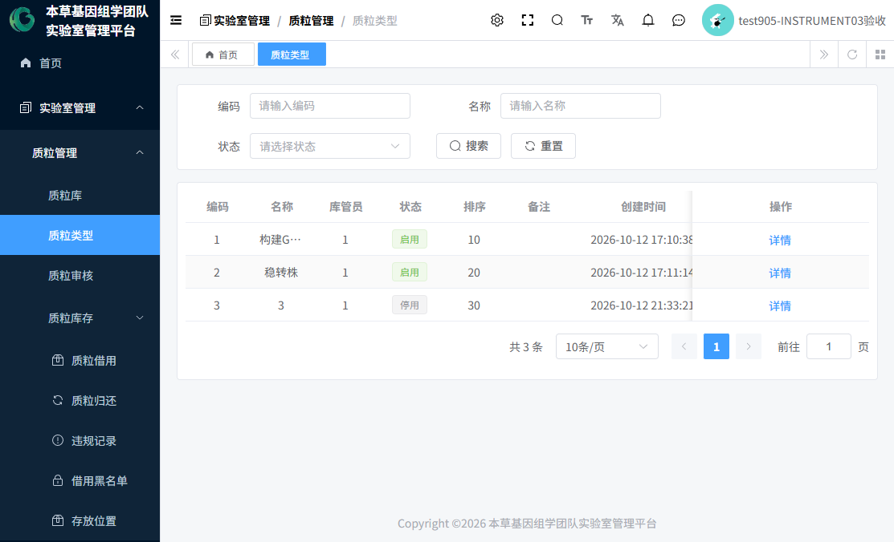
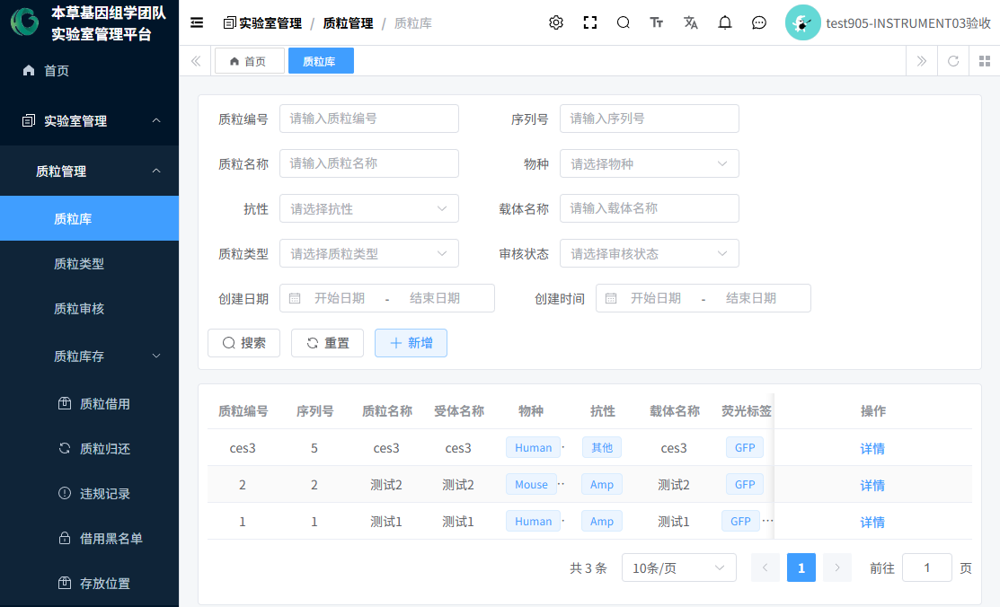
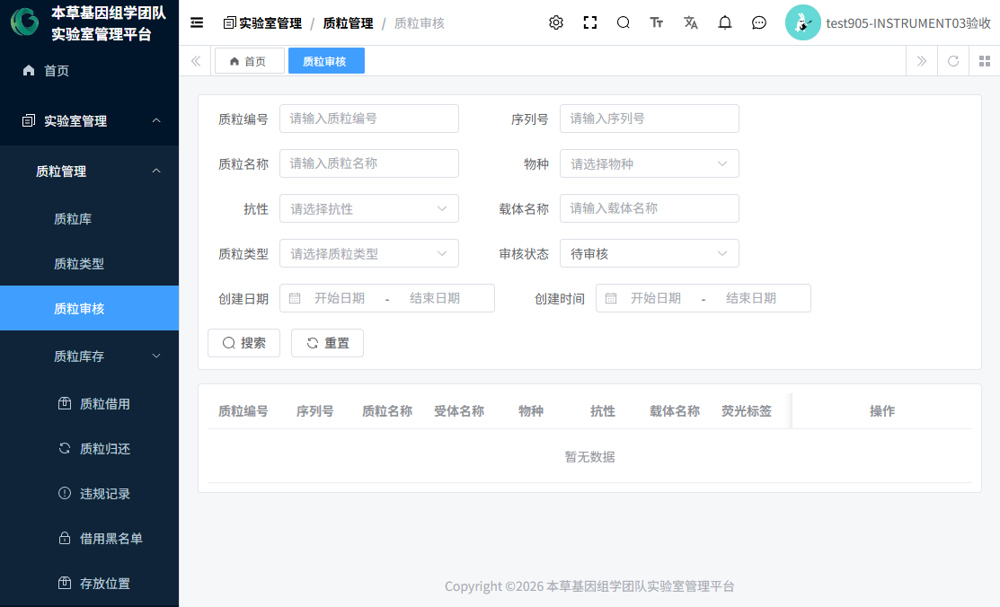
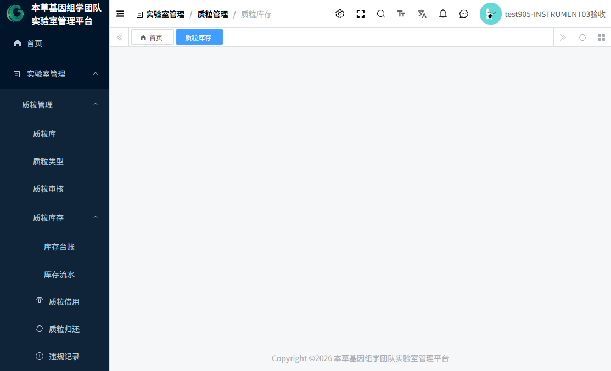
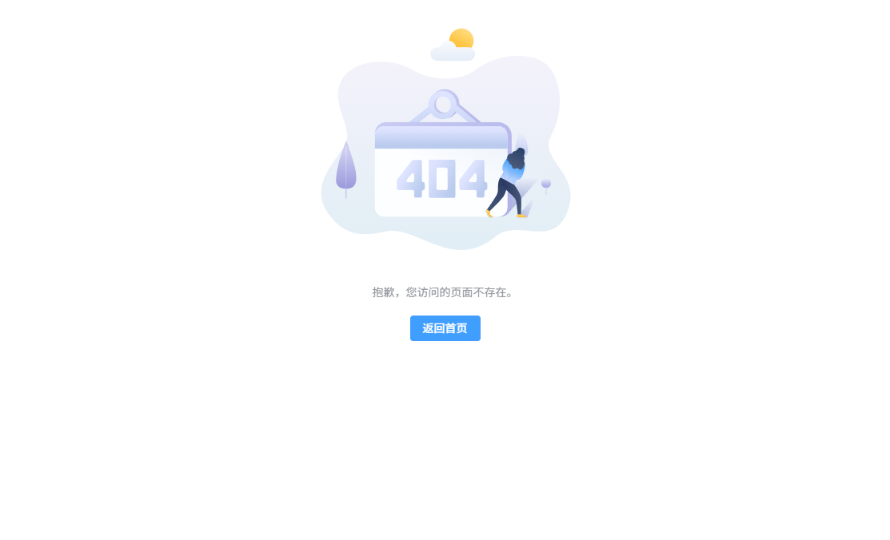
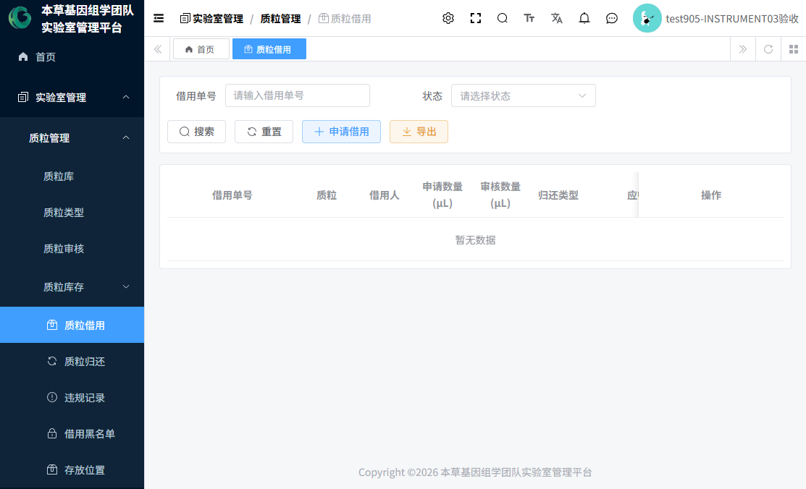
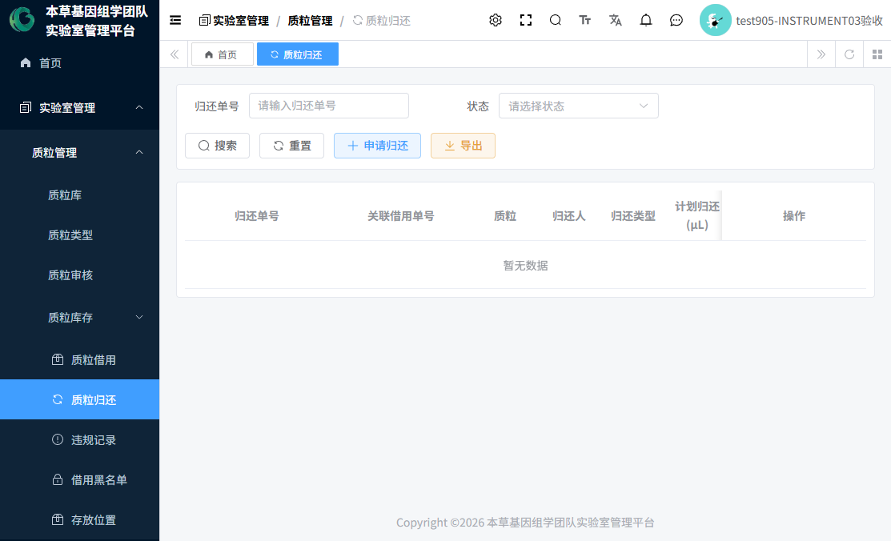
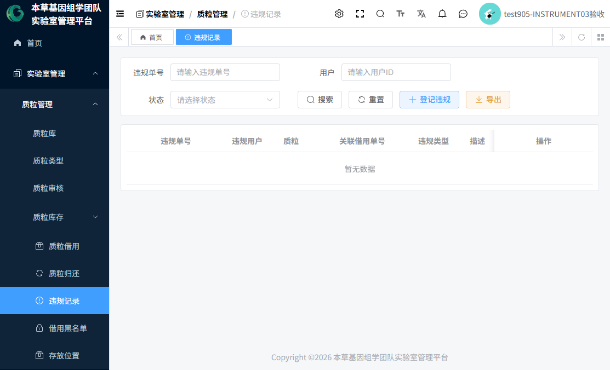
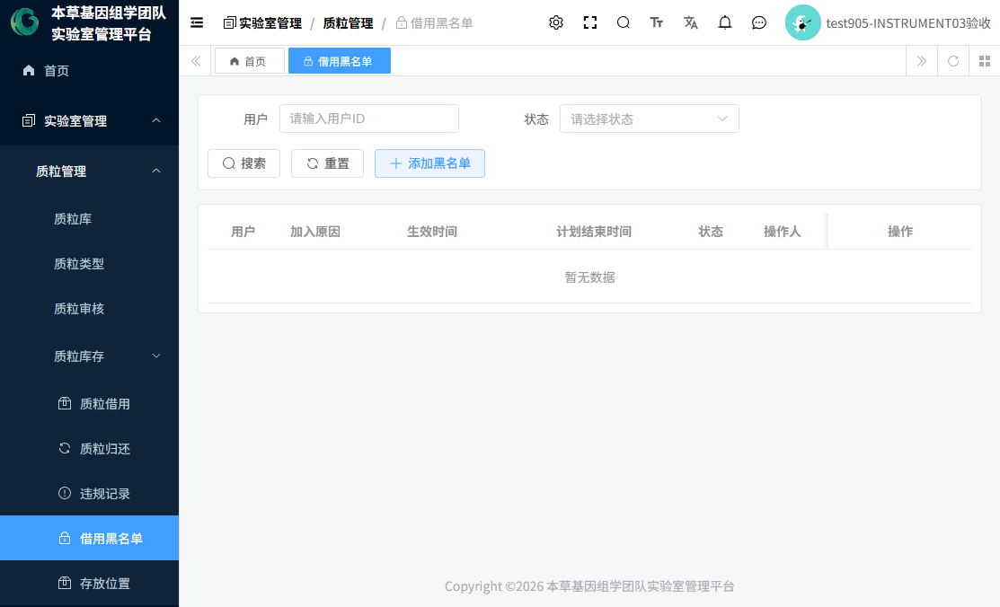
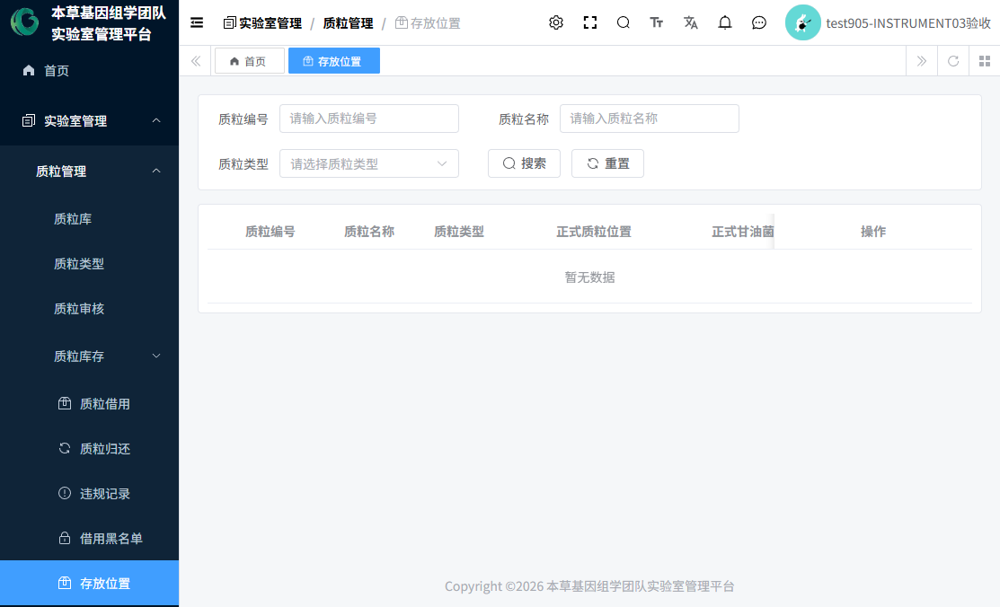

# 07 质粒管理操作指南

> 本指南覆盖质粒管理（V2）全部 9 个页面 + 实验室公告：**登记 → 审核 → 库存 → 借用 → 归还 → 违规/黑名单 → 存放位置** 的完整闭环。
> 编制日期：2026-10-20 ｜ 全部规则按当前实际系统核验。

---

## 1. 角色分工：先弄清"类型库管员"

质粒模块的核心组织方式：**每个"质粒类型"指定一名库管员，该类型质粒的审核、出入库、借还审批就归他管**。

| 角色 | 能做什么 |
|---|---|
| 普通用户 | 登记质粒、提交审核、查询质粒库（仅本人创建的+已通过的）、申请/取消借用、申请归还 |
| 库管员 | 本人负责类型的：质粒审核、库存出入库/盘点/调整/阈值、借用/归还审核、违规登记处理、黑名单、存放位置；也可自己登记和借用 |
| 本草基因管理员 / 租户管理员 | 查看全部数据、跨类型**审批**；但**直接出入库/盘点/调整等写操作仍须该类型库管员**（管理员不自动获得写权限） |
| 库管员不能做的 | 维护质粒类型（增删改归管理员）；任何仪器预约操作（库管员无仪器权限） |

## 2. 第一步：建立质粒类型（管理员）

菜单「实验室管理 → 质粒管理 → 质粒类型」（见 **图35**）。

1. 点「新增」：类型编码（租户内唯一）、类型名称、**库管员**（下拉只列拥有库管员角色的人）、状态（启用/停用）、排序、备注。
2. 保存后，该类型的所有待审质粒、库存事务都会出现在这位库管员的视野里。
3. 规则：类型被质粒引用后不能删除；库管员账号失效时列表红字提示，请及时重新指定。

## 3. 登记质粒（全体成员）

菜单「质粒库」→「新增」（见 **图34**）。

### 3.1 表单填写要点

| 分区 | 字段 | 必填 | 说明 |
|---|---|:-:|---|
| 基本信息 | 质粒编号 | ✔ | **手工填写**，租户内唯一，创建后不可修改 |
| | 质粒名称 / 受体 | ✔ | 文本 |
| | 物种 | ✔ | 人类 / 小鼠 / 大鼠 / 其他 |
| | 抗性 | ✔ | 氨苄 / 卡那 / 其他 |
| | 载体名称 | ✔ | 文本 |
| | 荧光/蛋白标签 | ✔ | 多选；**"无"不能与其他标签同选** |
| | 突变信息 / 改造信息 / 标签 | ✔ | 文本 |
| | 质粒类型 | ✔ | 仅"启用"的类型可选 |
| 保存信息 | 保存形式 | ✔ | 甘油菌 / 质粒DNA / 冻干（多选） |
| | 质粒浓度 | ✔ | ng/μL |
| | 体积 / 甘油菌规格与量 | — | 选填 |
| | 原始质粒位置 / 原始甘油菌位置 | — | 冰箱→层→盒→盒内位置；审核后固化为"原始申报位置" |
| 附件 | 序列图谱文件 或 无文件原因 | 二选一必填 | 都不填会被拦截 |
| | 测序/检测报告 | — | 选填附件 |
| 库存申报 | 初始库存申报数量 | 提交审核前必填 | **正式库存以库管员审核确认值为准**，此处仅为申报 |

### 3.2 提交与后续
1. 保存后状态为"草稿"；核对无误点「提交审核」（仅创建人可提交）。
2. 每次提交生成一轮审核记录，可多轮"驳回→修改→重提"。
3. 列表可见性：您只能看到自己创建的质粒和已审核通过的质粒；他人的未通过质粒不可见。

## 4. 审核入库（库管员 / 管理员）

菜单「质粒审核」（见 **图36**）。

1. 库管员只看到**本人负责类型**的待审质粒；管理员看全部。
2. 点「详情」核对：登记信息（只读）+ 审核历史。
3. 现场核查后：
   - **审核通过**：弹窗必填 **初始库存确认数量（μL）**（现场清点值，正式库存以此为准）+ 存储核查确认（保存形式、浓度、**正式质粒位置与正式甘油菌位置（冰箱/层/盒/盒内）**、序列图谱、低库存阈值等）。
     - 通过的同一时刻系统自动完成：质粒正式建档 → 建立库存账户（=确认数量）→ 写"期初入库"流水。任何一步失败整体回滚，不会出现"通过但没库存"的中间态。
   - **审核驳回**：审核意见**必填**；质粒回到"已驳回"，登记人修改后可重新提交。
4. 类型未指定库管员时无法审核（系统会提示），请管理员先去"质粒类型"补指定。

## 5. 库存台账与流水（库管员 / 管理员）

### 5.1 库存台账（见 **图37**）
每支已通过质粒一行：当前库存(μL)、低库存阈值、库存状态（正常/低库存/耗尽/停用）。

| 操作 | 说明 |
|---|---|
| 入库 / 出库 | 填数量（>0）+ 操作原因（必填）；库存不足不能出库 |
| 盘点 | 填实际清点数，系统按差额自动生成"盘点调整"流水 |
| 调整 | 手工校正库存，同样留痕 |
| 设置阈值 | 修改低库存阈值（低于阈值标记"低库存"） |
| 导出 | 导出 Excel |

- 前置校验：质粒已审核通过、数量>0、**操作人为该类型库管员**（管理员查看不限，但直接写操作仍须类型库管员）。
- 每次操作生成"业务单据"，同一请求重复提交自动幂等，不会重复动账。

### 5.2 库存流水（见 **图38**）
只读对账单：每一笔变化的流水号、类型、变化数量、变更前后库存、业务类型、关联单据、操作人。**不可修改、不可删除。**

## 6. 借用与归还（全员申请，库管员审批）

### 6.1 申请借用（见 **图39**）
「质粒借用」→「申请借用」：

| 字段 | 必填 | 说明 |
|---|:-:|---|
| 质粒 | ✔ | 仅"已审核通过"的质粒 |
| 申请数量(μL) | ✔ | >0 |
| 借用原因 | ✔ | 文本 |
| 应归还时间 | — | 建议填写，超期判定依据 |
| 归还类型 | ✔ | 质粒与甘油菌 / 仅质粒 / 仅甘油菌 / 无归还 / 其他（选"其他"必须填说明） |
| 归还要求 / 备注 | — | 选填 |

- **审核通过的那一刻，系统自动按批准数量出库**（生成单据+流水）；"无归还"类型的借用通过后直接完成。
- 批准数量必须 >0 且 ≤ 申请数量；审核时再次校验库存，防止并发超卖。
- 待审核状态申请人可「取消」。
- **黑名单拦截**：命中生效中黑名单的用户申请时收到统一提示"当前处于借用限制状态，暂时无法申请借用"（不显示原因等管理信息）。

### 6.2 超期自动化
定时任务自动扫描"已通过且超过应归还时间"的借用单 → 标记"已超期" → 自动生成一条"超期未还"违规记录（不会重复生成）。

### 6.3 申请归还（见 **图40**）
「质粒归还」→「申请归还」：选择**本人**的可归还借用单（显示已还进度）、归还类型、计划归还数量（不能超过剩余应还）。

- 库管员审核：通过必填"**实际确认归还数量**"，通过后系统自动入库；累计还清批准数量后借用单自动"归还完成"。驳回必填意见。

## 7. 违规与黑名单（库管员 / 管理员）

### 7.1 违规记录（见 **图41**）
- **人工登记**只能选两类：归还不合规（必须关联归还记录）/ 其他（库管员登记时必须关联本人负责类型的质粒）；"超期未还"由系统自动生成，人工不可选。
- 处理：待处理 → 已处理（填处理结果）。

### 7.2 借用黑名单（见 **图42**）
- 「添加」：库管员必须关联**本人管理范围内**的违规记录，加入原因必填；同一用户不允许重复生效中的黑名单。
- 生效中的黑名单**全局拦截**该用户的一切借用申请。
- 「解除」：仅生效中可解除，解除原因必填。

## 8. 存放位置（库管员 / 管理员，见 **图43**）

- 每支质粒两套四级位置：**质粒位置**和**甘油菌位置**（冰箱 → 层 → 盒 → 盒内位置）。
- 「修改位置」：改哪一组，哪组的四项必须完整填写；至少修改一组；仅"已审核通过"的质粒可改；每次修改写历史。
- 详情分两个区展示：**正式位置**（当前生效）与**原始申报位置**（登记人最初申报，永不覆盖）。

## 9. 常见问题与错误提示（实测文案）

| 提示 | 原因与处理 |
|---|---|
| 质粒编号已存在 | 换编号；编号创建后不可改 |
| 荧光标签"无"不能与其他同选 | 重新勾选标签 |
| 序列图谱文件与无文件原因必须二选一填写 | 补其一 |
| 提交审核前必须填写初始库存申报数量 | 回编辑页补填 |
| 该质粒类型尚未指定库管员，无法审核 | 管理员去"质粒类型"指定库管员 |
| 驳回时必须填写审核意见 | 审批人补填 |
| 库存不足，无法出库/申请借用 | 先入库或减少数量 |
| 只能为本人借用单申请归还 | 不能替他人归还 |
| 归还数量超过应归还剩余数量 | 减少归还数量 |
| 归还不合规违规必须关联归还记录 | 登记时选择关联归还单 |
| 该用户已存在生效中的黑名单 | 先解除旧黑名单再添加 |
| 当前处于借用限制状态，暂时无法申请借用 | 您在黑名单中，联系库管员 |
| 被驳回的质粒想修改再提交 | **当前版本列表页对已驳回质粒暂未提供编辑按钮（已知待改进项）**，请联系管理员处理 |

## 10. 本模块未实现/注意项（如实标注）

1. **质粒"停用"无操作入口**：状态定义存在、借用与库存环节会拦截停用质粒，但当前没有任何停用/启用质粒的页面按钮或接口——如需停用请联系管理员处理数据。
2. **已驳回（REJECTED）质粒前端无编辑/再提交按钮**：后端支持"驳回后修改重提"，但列表页按钮当前只对草稿显示——请通过管理员协助，或等待版本修复。
3. 库存流水字典中的"借用/归还/报废"类型为预留展示，当前实际产生的流水为入库/出库/盘点调整三类。
4. 违规记录、借用黑名单功能完整，但当前租户暂无业务数据（功能可用）。

## 11. 实验室公告

菜单「实验室管理 → 实验室公告管理」（见 **图30**）：本草基因管理员/租户管理员发布维护公告（标题、内容、状态）。**无推送机制**，请线下告知成员查看。

---

*编制日期：2026-10-20 ｜ 配套阅读：《01-平台功能与角色权限总览》权限矩阵。*
