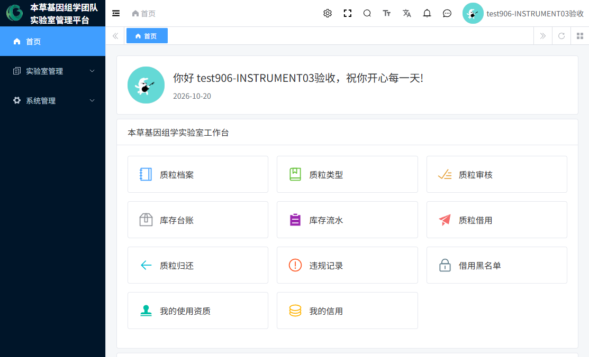
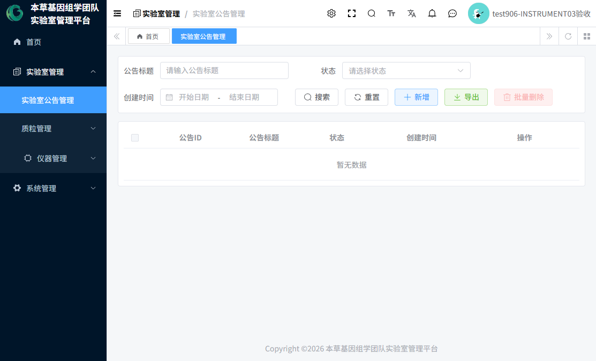
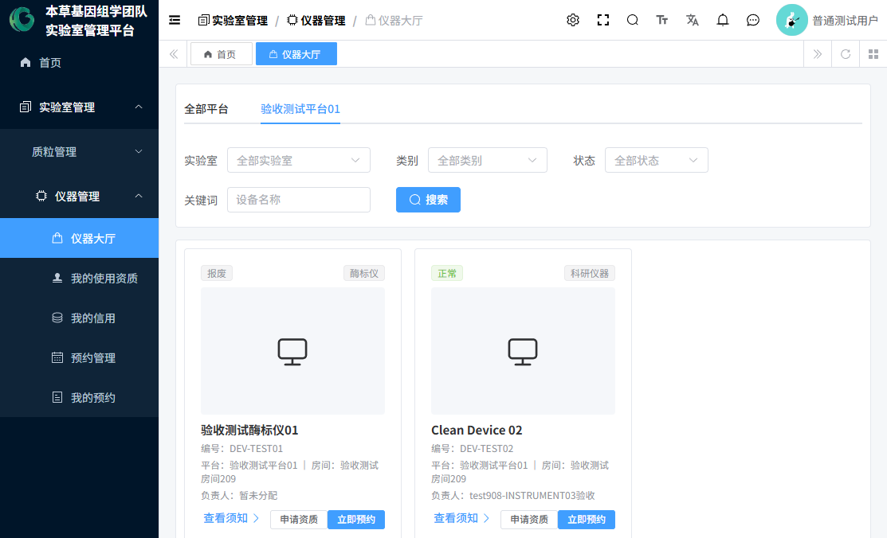
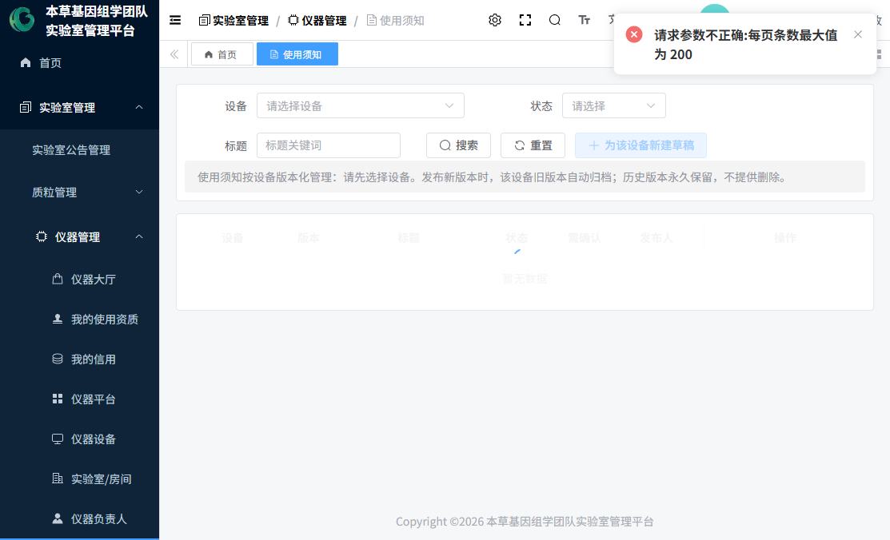
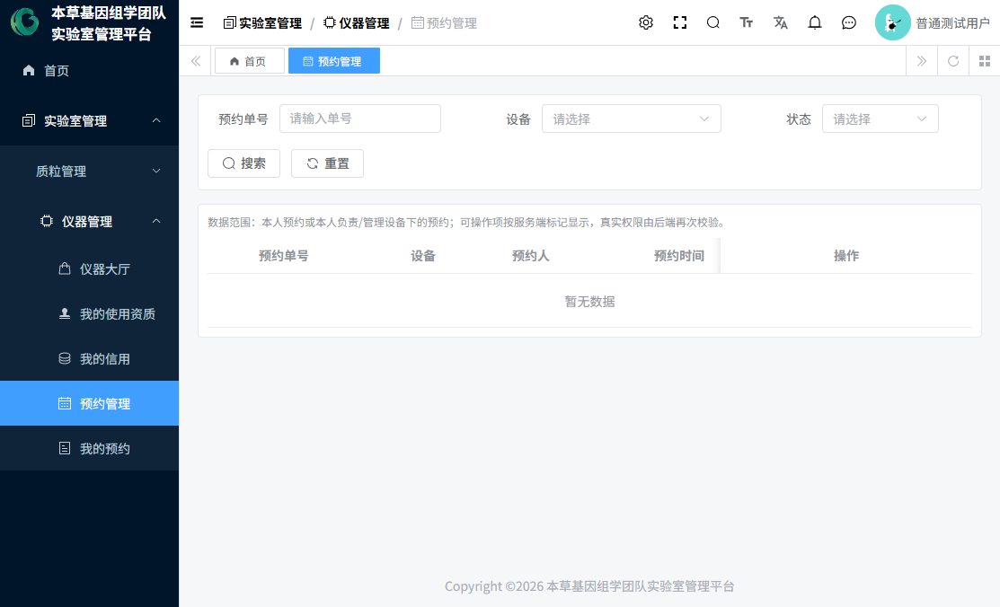

# 08 全部菜单功能字典

> 本字典逐项覆盖当前租户（成都中医药大学，套餐 114）实际存在的全部菜单，包括实验室业务菜单与框架自带菜单。每项含：功能目的、可见角色、页面内容、主要操作、关键规则、常见问题、关联流程、实现状态与截图。
>
> **"可见角色"为实测登录菜单**；"可操作"另见各节说明——菜单可见 ≠ 按钮可用 ≠ 数据可管。
>
> 编制日期：2026-10-20。

---

## 一、通用页面（无菜单项或隐藏菜单）

### 工作台（首页）
- **进入方式**：登录后默认首页。
- **功能**：登录后的起始页，展示欢迎信息与常用入口。
- **可见**：所有登录用户。
- **截图**：图3（普通用户视角）、图16（管理员视角）。

### 仪器详情（隐藏菜单，路由 /lab/instrument/device-detail）
- **进入方式**：从"仪器大厅"点击设备卡片进入，不在左侧菜单显示。
- **功能**：单台设备的完整信息页：顶部信息（编号/类别/维修口径/型号/规格/资产编号/厂家/购置日期/允许预约/平台/房间/备注）＋"我的使用资质"＋"当前负责人"＋"使用须知"三块，右上角提供「申请资质」「立即预约」按钮。
- **可见**：拥有大厅权限的角色（903/904/906）。
- **截图**：图6、图7。

### 个人中心（隐藏菜单，路由 /profile）
- **进入方式**：右上角头像下拉 → 个人中心。
- **功能**：基本信息（昵称、手机号、邮箱、性别、身份类别、研究方向、导师、指导教师、起止年月）、上传头像、重置密码、社交绑定（视部署而定）。
- **规则**：手机号/邮箱为直接保存，**没有短信/邮箱验证码环节**（如实标注）。
- **可见**：所有登录用户。
- **截图**：图15。

---

## 二、实验室管理 → 实验室公告管理

| 项 | 说明 |
|---|---|
| 完整路径 | 实验室管理 → 实验室公告管理 |
| 功能目的 | 发布和维护实验室通知公告（标题+内容+状态） |
| 可见角色 | 租户管理员、本草基因管理员 |
| 页面内容 | 筛选（公告标题、状态 0 正常/1 关闭、创建时间）；列表（公告ID、标题、状态、创建时间） |
| 操作按钮 | 新增、编辑、删除、批量删除、导出 |
| 业务规则 | 纯管理端维护；**无推送、无已读回执**，用户需主动进入菜单查看 |
| 实现状态 | 已实现（当前租户暂无公告数据） |
| 截图 | 图30 |

> 注意：本页与"系统管理 → 消息中心 → 通知公告"（框架公告）是**两套独立功能**，互不相通。

---

## 三、实验室管理 → 质粒管理（9 项）

### 3.1 质粒库
- **功能**：质粒档案登记与查询——每支质粒的"身份证"。
- **可见**：903/904/905/906。**数据范围**：列表只显示本人创建的或已审核通过的质粒。
- **筛选**：质粒编号、序列号、名称、物种、抗性、载体、类型、审核状态、创建日期等。
- **操作**：详情（所有人）；编辑/提交审核/删除（仅草稿状态显示，且仅创建人）。
- **表单要点**：质粒编号（手填、租户内唯一、创建后不可改）、名称、受体、物种、抗性、载体名称、荧光标签（"无"不能与其他同选）、突变、修饰、标签、质粒类型（仅启用类型）、保存形式（甘油菌/质粒DNA/冻干多选）、浓度、体积、甘油菌规格/量、原始存放位置（冰箱/层/盒/盒内）、序列图谱文件或"无文件原因"（二选一必填）、测序报告、初始库存申报（提交审核前必填）。
- **状态机**：草稿 → 待审核 → 审核通过 / 审核驳回（→ 修改后再提交，可循环）。
- **常见问题**：编号重复被拒；提交时缺初始库存申报或序列图谱被拦截。
- **关联流程**：提交后到「质粒审核」审批。
- **实现状态**：已实现。注意：前端列表对"已驳回"质粒暂未提供编辑/再提交按钮（后端支持），被驳回后请联系管理员处理。
- **截图**：图34。

### 3.2 质粒类型
- **功能**：质粒分类，并为**每个类型指定一名库管员**——类型归谁管，谁就负责该类型的审核与出入库。
- **可见**：903/904/905/906；**增删改仅 903/906**（库管员只读）。
- **表单**：类型编码（租户内唯一）、名称、库管员（下拉仅列有库管员角色的人，选填）、状态（启用/停用）、排序、备注。
- **规则**：类型被质粒引用时不可删除；库管员失效时列表红字提示。
- **截图**：图35。

### 3.3 质粒审核
- **功能**：库管员的入库验收台。现场核查后"通过"即正式建档入库。
- **可见**：903/905/906。数据范围：超管/本草基因管理员全部；库管员仅本人负责类型。
- **操作**：审核通过 / 审核驳回（仅待审核行）。
- **通过弹窗必填**：**初始库存确认数量**（正式库存以此为准，不用登记人申报值）＋ 存储核查确认（保存形式、浓度、正式质粒/甘油菌位置四件套、序列图谱、低库存阈值等）。
- **规则**：驳回必填意见；类型未指定库管员时报"该质粒类型尚未指定库管员，无法审核"；通过在同一事务内完成建档+建库存+写期初流水。
- **截图**：图36。

### 3.4 库存台账
- **功能**：每支已通过质粒的"银行账户"——当前库存、低库存阈值、库存状态（正常/低库存/耗尽/停用）。
- **可见**：903/905/906。
- **操作**：入库、出库、盘点、调整、设置阈值、导出（写操作要求：质粒已审核通过、数量>0、操作人为该类型库管员）。
- **规则**：每次操作生成业务单据与流水，同一请求号重复提交幂等；库存不足不能出库。
- **截图**：图37。

### 3.5 库存流水
- **功能**：库存对账单（入库/出库/盘点调整/期初等全部变动留痕），只读。
- **可见**：903/905/906。
- **说明**：当前实际产生的流水为入库/出库/盘点调整三类；字典中另有"借用/归还/报废"类型为预留展示。
- **截图**：图38。

### 3.6 质粒借用
- **功能**：成员申请取用质粒，库管员审核批准后**自动出库**；超期由定时任务自动转"已超期"并生成违规。
- **可见**：903/904/905/906。数据范围：管理员全部、库管员限本人类型、普通用户仅本人。
- **申请字段**：质粒（仅已审核通过）、申请数量(μL)、借用原因（必填）、应归还时间、归还类型（五选一：质粒与甘油菌/仅质粒/仅甘油菌/无归还/其他，选"其他"必须填说明）、归还要求、备注。
- **审核**：批准数量 >0 且 ≤ 申请数量，审核时再次校验库存；驳回必填意见；"无归还"类型通过即直接完成。
- **状态机**：待审核 → 审核通过（已出库）→ 归还完成 / 已超期；待审核 → 驳回 / 已取消。
- **规则**：命中"生效中黑名单"的用户申请时被通用文案拦截（不泄露管理信息）。
- **截图**：图39。

### 3.7 质粒归还
- **功能**：借用人归还质粒，库管员确认实际收到数量后自动入库；累计还清后借用单自动完成。
- **可见**：903/904/905/906。
- **申请字段**：借用单（仅本人可归还状态的借用单，显示已还进度）、归还类型、计划归还数量（≤剩余应还）、备注。
- **审核**：通过必填"实际确认归还数量"；驳回必填意见。
- **截图**：图40。

### 3.8 违规记录
- **功能**：登记与处理质粒违规（超期违规由系统自动生成）。
- **可见**：903/905/906。
- **登记字段**：违规用户、违规类型（人工仅可选：归还不合规/其他；超期为系统专属）、描述（必填）、发生时间、关联借用单。**归还不合规必须关联归还记录**；库管员不得登记无质粒的违规。
- **处理**：待处理 → 已处理（填处理结果）。
- **截图**：图41。

### 3.9 借用黑名单
- **功能**：对屡次违规用户停止借用资格；生效中的黑名单全局拦截其借用申请。
- **可见**：903/905/906。
- **操作**：添加（库管员必须关联本人管理范围内的违规记录；超管可不关联；加入原因必填；同一用户不允许重复生效黑名单）、解除（仅生效中可解除，原因必填）。
- **截图**：图42。

### 3.10 存放位置
- **功能**：质粒在冰箱中的"门牌号"账本（冰箱→层→盒→盒内位置，质粒与甘油菌各一套），改动留历史。
- **可见**：903/905/906。
- **规则**：仅审核通过的质粒可改；修改哪组哪组四项必须完整；至少填一组；原始申报位置不会被覆盖，详情分两区展示。
- **截图**：图43。

---

## 四、实验室管理 → 仪器管理（15 项）

### 4.1 仪器大厅
- **功能**：面向所有用户的仪器浏览与预约入口。按平台页签分组，卡片显示状态/类别/图片/名称/编号/平台/房间/负责人。
- **可见**：903/904/906。
- **操作**：查看须知（进详情）、申请资质、立即预约（未开放预约的设备按钮置灰并提示）。
- **筛选**：实验室（房间）、类别、状态、设备名称关键词。
- **截图**：图4、图5。

### 4.2 仪器平台
- **功能**：平台档案（仪器业务归属）维护。
- **可见**：903/906。
- **操作**：新增/编辑/启停用/删除（被设备引用时不可删）。
- **截图**：图17。

### 4.3 仪器设备
- **功能**：设备档案维护与状态管理（全生命周期的核心页）。
- **可见**：903/906；**908 也有此菜单**（用于查看自己负责的设备档案）。
- **操作**：新增/编辑/状态（状态机：正常、维护、故障、停用、报废终态）/删除（仅停用/报废，且须先解除全部生效负责人）/详情。负责人列点击弹抽屉查看当前与历史负责人（只读，修改去"仪器负责人"页）。
- **截图**：图19、图20。

### 4.4 实验室/房间
- **功能**：房间档案维护；列表"维修负责人"列展示该房间生效中的维修负责人。
- **可见**：903/906。
- **操作**：新增/编辑/删除（有设备引用时拒绝）。
- **截图**：图18。

### 4.5 仪器负责人
- **功能**：设备负责人/平台负责人/实验室维修负责人的分配与解除，全部历史留痕。
- **可见**：903/906。
- **操作**：分配负责人、解除（原因必填）、历史（时间线）。
- **规则**：维修负责人允许多名同时生效；设备/平台同类型再分配自动解除原负责人。
- **截图**：图21、图22。

### 4.6 使用须知
- **功能**：按设备版本化管理使用须知（新版本发布后旧版本自动归档，历史永久保留、无删除）。
- **可见**：903/906。
- **操作**：新增草稿（必须先选设备）、编辑、发布（仅草稿）、查看。
- **规则**：**"要求确认"开关本期仅存档展示，预约前确认环节尚未实现**（页面与详情页均有标注）。
- **截图**：图23。

### 4.7 我的使用资质
- **功能**：个人视角的资质（上区）与申请记录（下区）；待审核申请可撤回。
- **可见**：903/904/906/908。
- **截图**：图10。

### 4.8 我的信用
- **功能**：个人信用分卡片、信用说明、本人积分流水、我的暂停记录。
- **可见**：903/904/906。
- **截图**：图11。

### 4.9 资质审核
- **功能**：双页签——申请审核（通过/驳回/历史）+ 资质列表（查看/撤销）。
- **可见**：903/906（管理员看全部）、908（仅负责设备）。
- **规则**：驳回意见必填；通过可选"有效期至"（不填长期）；通过时自动初始化信用账户（首次 100 分）；撤销原因必填。
- **截图**：图24。

### 4.10 信用管理
- **功能**：信用账户列表 + 积分流水（可导出）+ 人工加扣分。
- **可见**：903/906（数据范围仅管理员）；908 无菜单但接口层允许对授权设备用户调分。
- **规则**：变动值不能为 0、允许负分；变动原因必填入流水；流水不可改。
- **截图**：图25。

### 4.11 暂停管理
- **功能**：创建/解除"使用暂停"（单仪器/全部仪器）。
- **可见**：903/906。
- **规则**：创建即生效并联动暂停资质；解除原因必填；**到期不自动解除**（人工解除语义）。
- **截图**：图26。

### 4.12 预约配置
- **功能**：按设备配置预约规则与开放窗口。
- **可见**：**仅 906**。
- **规则**：未配置启用规则的设备不开放预约；窗口模式为选配进阶。
- **截图**：图27。

### 4.13 预约管理
- **功能**：预约查询与管理（取消/调整/完成/作废/历史）。
- **可见**：906（全部）、908（负责设备）、904（本人数据，完成/作废按钮不可见）。
- **规则**：完成需填实际起止；作废原因必填；本人取消/调整限开始前。
- **截图**：图28、图29、图29b、图14（普通用户视角）。

### 4.14 我的预约
- **功能**：本人全部预约记录；可详情/取消/调整/历史。**无新建按钮**（预约从大厅/详情发起）。
- **可见**：903*/904/906/908（903 有菜单但页面数据按本人返回）。
- **截图**：图12。

### 4.15 仪器详情（隐藏菜单）
见"一、通用页面"。

---

## 五、系统管理（框架 + 业务）

### 5.1 注册审批（业务菜单，路由 /system/register-apply）
- **功能**：新用户注册申请的审批工作台（默认筛选"待审批"）。
- **可见**：903/906/907。**907 登录后仅此一个业务菜单**（见 **图44**）。
- **操作**：详情（含审批历史时间线）、通过（可选意见）、驳回（意见必填）。
- **规则**：通过自动创建正式账号并授予"普通用户"角色、转移用户名占用、清空申请密码；通过后**不建信用账户、不配部门岗位、不发通知**。
- **截图**：图31、图44。

### 5.2 用户管理（框架标准功能）
- **可见**：903（全权限）、906（缺"恢复已删用户"）。
- **功能**：按部门树管理用户：新增（可分配部门/岗位/角色）、编辑、停用/启用、删除/恢复、重置密码、导入导出。
- **注意**：注册审批通过的用户部门/岗位为空，需要管理员在此补录。
- **截图**：图32。

### 5.3 角色管理（框架标准功能）
- **可见**：903（全部）、906（只读）。
- **功能**：角色增删改、菜单权限分配、数据权限、导出。
- **截图**：图33。

### 5.4 其余框架菜单（仅 903 租户管理员可见）
| 菜单 | 功能 | 与实验室业务关系 |
|---|---|---|
| 菜单管理 | 维护菜单树与按钮权限 | 支撑权限体系，一般由系统负责人维护 |
| 部门管理 / 岗位管理 | 组织架构与岗位维护 | 可选使用；注册用户默认无部门岗位 |
| 字典管理 | 下拉选项字典（设备类别、质粒字典等） | 业务字典的维护入口 |
| 租户管理（租户列表/租户套餐） | 多租户与套餐配置 | 系统级配置 |
| 消息中心（通知公告、短信/邮箱/站内信管理） | 框架通知与消息渠道管理 | **实验室业务当前未接入任何自动通知**，均为空置管理页 |
| 审计日志（操作日志/登录日志） | 操作留痕查询 | 审计用 |
| 基础设施（代码生成、数据源配置、表单构建、API 接口、API 日志、WebSocket、文件管理、定时任务、配置管理、监控中心） | 框架运维功能 | 与业务无直接关系；"定时任务"中当前**无任何仪器相关任务**（可佐证暂停/资质自动到期未启用） |
| 工作流程（流程管理、审批中心、OA 示例） | 框架 BPM 引擎与示例 | 实验室业务未使用流程引擎 |

> 框架菜单实现状态：均为框架自带功能，已实现；但实验室业务未依赖它们，普通用户/库管员/审批专员/设备负责人均不可见。

---

## 六、菜单实现状态总表

| 菜单 | 实现状态 | 备注 |
|---|---|---|
| 仪器管理全部 15 页 | 已实现 | 使用须知"确认环节"仅存档未闭环 |
| 质粒管理全部 10 页 | 已实现 | 质粒"停用"无操作入口；REJECTED 行前端无编辑按钮 |
| 实验室公告管理 | 已实现 | 当前无数据 |
| 注册审批 | 已实现 | 无消息通知 |
| 用户/角色管理 | 已实现 | 框架标准功能 |
| 框架系统管理/基础设施/工作流程 | 已实现 | 框架自带 |
| 维修模块（工单） | **未实现** | 仅有数据表预留，无页面/接口 |
| 暂停自动到期 / 资质自动到期 | **未实现** | 代码预留未调度，人工处理 |

---

*编制日期：2026-10-20 ｜ 本字典与当前运行系统逐菜单实测核对，如后续版本菜单调整，请以新版本核验为准。*
